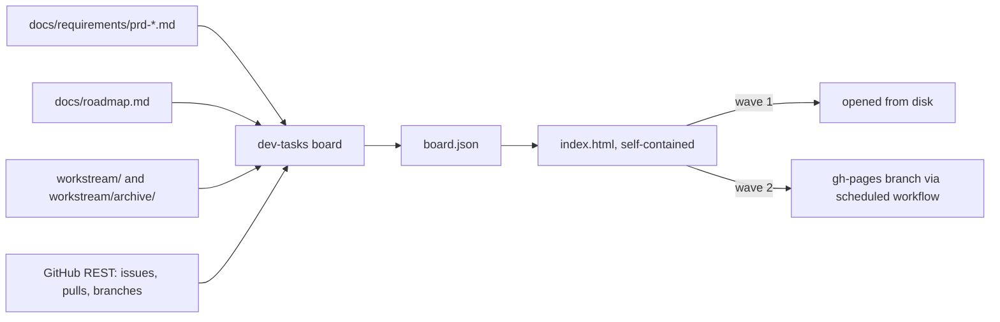
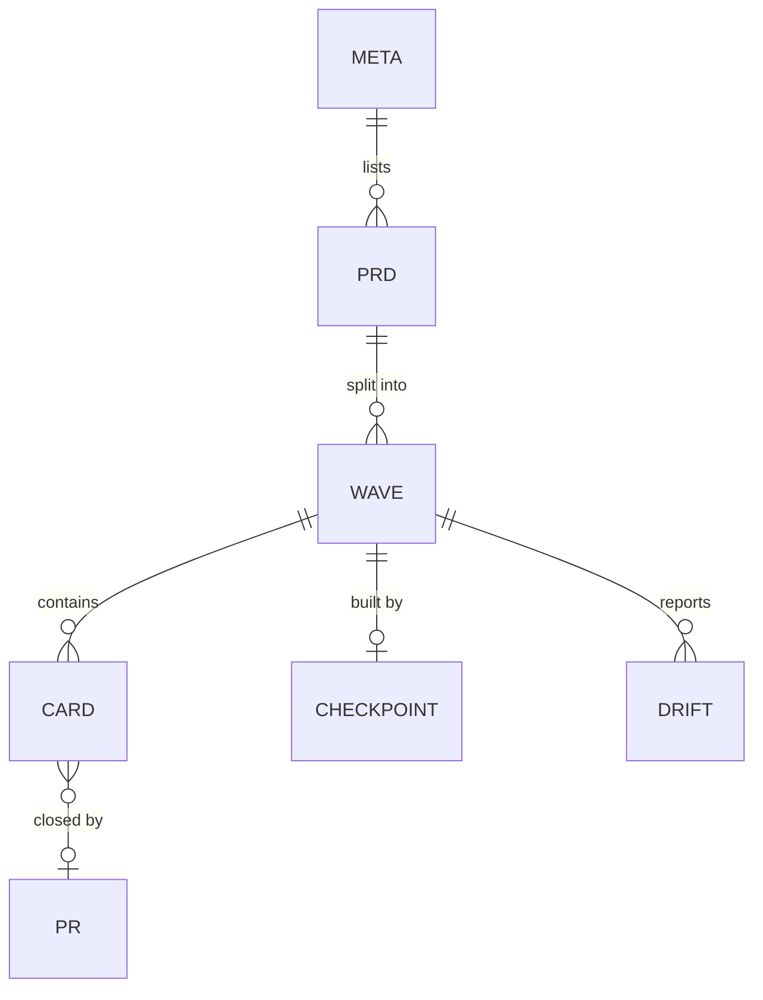

# PRD: factory-board — a generated, read-only board of waves, stories, and progress

## Changelog

| Version | Date       | Summary                                                                                                                                                                                      | Author                    |
| ------- | ---------- | -------------------------------------------------------------------------------------------------------------------------------------------------------------------------------------------- | ------------------------- |
| 1.3     | 2026-10-19 | OQ-4 deferred by @llipe to the wave 2 spec: decide the workflow triggers after wave 1 is built and used.                                                                                     | @llipe / product-engineer |
| 1.2     | 2026-10-19 | OQ-3 resolved: the command also prints a one-screen terminal summary (D-13, FR-21, AC-12).                                                                                                   | @llipe / product-engineer |
| 1.1     | 2026-10-19 | OQ-1 and OQ-2 resolved: page ships in wave 1 (D-11), the command inlines the JSON into the page (D-12). No decision remains pending.                                                         | @llipe / product-engineer |
| 1.0     | 2026-10-18 | Initial draft from the review of the Claude Design "Software Factory" canvas. Decisions D-01 to D-12 in `workstream/decisions-factory-board.md`; D-11 and D-12 pending (see Open Questions). | @llipe / product-engineer |

## Executive Summary

dev-tasks already records where every feature stands, but across four places: PRD files, `docs/roadmap.md`, the artifacts under `workstream/`, and GitHub issues and pull requests. Nobody can see the whole picture without opening all four. This PRD adds one deterministic command, `dev-tasks board`, that reads those sources and renders a single static page showing what is being worked on, what is next, what is pending, and how far each PRD has come. The page invents no status: every segment, card and count is derived from evidence the workflow already produces (D-01, D-08, D-09).

## Feature Overview

`dev-tasks board` is one command, one JSON schema, one HTML template, and one scheduled workflow template. The command walks the repository and the GitHub REST API, writes `board.json`, and inlines it into a self-contained `index.html` under a gitignored folder (D-06, D-12). The page renders a roadmap with one lane per PRD and one card per wave, a wave-detail panel that names the artifact behind each of the eight wave stages, a story board per integration branch, the planner checkpoints, and a list of roadmap drift. The Claude Design canvas that prompted this PRD is the mockup for that page; the shipped page is a port, not the canvas (D-02).

| Wave | Ships                                                                                                                                                                                      |
| ---- | ------------------------------------------------------------------------------------------------------------------------------------------------------------------------------------------ |
| 1    | `dev-tasks board` command, `board.json` schema, the HTML template, fixtures and tests, a runbook, and the one-line publish-skill change that makes the story-to-wave link mandatory (D-03) |
| 2    | Hosted board: a scheduled GitHub Actions workflow template that regenerates the page and pushes it to a `gh-pages` branch; waiting-on-you heuristics; activity derived from PR events      |

The data flow is the same in both waves:

## Goals and Objectives

1. **One page answers four questions.** What is in progress, what is next, what is pending on the user, and how far each PRD is. Measured by: every question is answerable from the page without opening GitHub or a workstream file.
2. **Nothing is typed by hand.** Every value on the page traces to a file or an API response. Measured by: `board.json` contains no field a human edits.
3. **Honest about gaps and staleness.** A wave that shipped without an audit shows the gap (D-05); a page older than a day says so.
4. **No backend, no build step, no framework.** One command, one JSON file, one HTML file. The page works opened from disk.
5. **Works for every consumer.** Any repository that follows the dev-tasks naming conventions gets a correct board; Copilot and Kiro consumers are not excluded by a Claude-only surface (D-01, D-02).

## Affected Repositories

| Repository        | Role / Impact                                                                                                                                                                                                                                                                                               |
| ----------------- | ----------------------------------------------------------------------------------------------------------------------------------------------------------------------------------------------------------------------------------------------------------------------------------------------------------- |
| `llipe/dev-tasks` | Sole repository. Adds the `board` command under `bin/` and `core/`, the HTML template under `templates/board/`, a workflow template under `templates/workflows/`, two runbooks, fixtures and tests, one line in `activity-publish-github` across the three skill trees, and a `bundle-manifest.json` entry. |

Consumer repositories receive the command through the package and the workflow template through `templates/`. The generated folder is self-ignoring and never committed (D-06).

## Target Users

- **Primary:** the solo developer or small team running dev-tasks who wants to see the state of all PRDs at a glance, especially while several agent runs are in flight.
- **Secondary:** a reviewer or stakeholder given the hosted page link who needs to know what shipped and what is waiting on a human, without repository access.

## User Stories

1. As a developer, I want to run one command and open a page that shows every PRD, its waves, and the stage each wave is in, so that I do not reconstruct status from four sources.
2. As a developer, I want each wave card to show which of the eight stages have evidence and which do not, so that a wave that skipped its audit is visible as a gap, not hidden by a count (D-05).
3. As a developer, I want a board of story cards per integration branch, placed by pull-request state rather than by a label someone forgot to move, so that the board cannot drift from GitHub (D-10).
4. As a developer, I want the page to list every place where `docs/roadmap.md` disagrees with GitHub, so that the roadmap gets corrected in the next consolidated PR (D-09).
5. As a developer, I want to see each active planner checkpoint, its current story, and whether it is blocked, so that I know which runs need me (D-04).
6. As a developer, I want the command to still produce a page when GitHub is unreachable, with the GitHub-sourced sections marked absent, so that an offline run is useful rather than fatal.
7. As a stakeholder, I want a hosted page that refreshes on a schedule without anyone approving a PR, so that the link I was given is current (D-06).
8. As a maintainer, I want the generator covered by fixture tests, so that a change in a naming convention fails a test before it blanks the board (D-01).

## Functional Requirements

### Command (wave 1)

- **FR-1.** `dev-tasks board` is a new subcommand of the existing CLI alongside `install`, `update`, `status`, `pin`, `unpin`, `doctor` and `migrate`. It takes no options in wave 1 (`SIMPLICITY.md` A2).
- **FR-2.** The command writes `.dev-tasks/board/board.json` and `.dev-tasks/board/index.html`, and a `.dev-tasks/board/.gitignore` containing `*` so the folder ignores itself without touching the consumer's `.gitignore` (D-06).
- **FR-3.** The command reads, in this order: `docs/requirements/prd-*.md`; `docs/roadmap.md`; `workstream/` and `workstream/archive/`; then GitHub through `gh api` REST endpoints for issues, pull requests and branches. It never calls GraphQL.
- **FR-4.** If `gh` is missing, unauthenticated, or the API call fails, the command still writes both files, sets `meta.github` to `"unavailable"` with the reason, leaves `cards` and `checkpoints[].pr` empty, and exits with `ExitCode.DependencyError`. The page renders a banner naming the reason.
- **FR-5.** The command resolves each PRD from its file: `slug` from the filename, `title` from the first heading, and the wave list from the roadmap rows that link to the file. A PRD with no roadmap row appears as one wave named `All` with every stage unknown.
- **FR-6.** For each wave, the command records a per-stage evidence result for the eight wave stages (D-05). The stage is `present` when its evidence exists, `absent` otherwise:

| Stage   | Evidence                                                                                                      |
| ------- | ------------------------------------------------------------------------------------------------------------- |
| Refine  | the PRD file exists                                                                                           |
| Spec    | `workstream/specification-<slug>-phase-<N>.md` (or the archived copy)                                         |
| Stories | `workstream/user-stories-<slug>-phase-<N>.md` (or archived)                                                   |
| Publish | `workstream/github-publication-<slug>-phase-<N>.md` (or archived), or at least one issue resolves to the wave |
| Plan    | `workstream/tasks-<slug>-phase-<N>-plan.md` (or archived)                                                     |
| Build   | a `planner-state-*.md` whose source names the wave's task plan, or every story card is Merged or Done         |
| Audit   | `workstream/fidelity-report-<slug>-phase-<N>-rollup.md` (or archived)                                         |
| Ship    | the roadmap row reads `Done`                                                                                  |

- **FR-7.** A story issue resolves to its wave by the `**Story:** workstream/user-stories-<slug>-phase-<N>.md → S-NNN` line in its body (D-03). An issue whose title carries the `[PRD-<slug>]` prefix but whose body lacks the line is attached to the PRD with `wave: null` and listed as unfiled.
- **FR-8.** A card's stage is derived in this precedence (D-10): `done` when the issue is closed and the wave's roadmap row reads Done; `merged` when a PR with `Closes #N` in its body is merged into a non-default branch; `review` when such a PR is open; `prog` when `status: in-progress` is set, or a branch named `story/S-NNN-*` for the wave exists with no open PR; `ready` when `status: ready` is set; otherwise `backlog`. `blocked` is a flag, set by `status: blocked` or by a blocked row in a planner checkpoint, and does not change the stage.
- **FR-9.** Each `planner-state-*.md` not under `archive/` becomes one checkpoint entry: the plan id, the wave it serves, the current position, the last-updated timestamp, and the blocked rows (D-04).
- **FR-10.** Roadmap drift is computed, never stored by hand (D-09): a row reading `Not started` whose wave has any card past `backlog`; a row reading `In progress` whose cards are all `done`; a row reading `Done` with an `absent` Audit stage; a PRD file with no roadmap row; a roadmap row whose PRD file is missing.
- **FR-11.** `board.json` carries `meta.generatedAt` as an RFC 3339 timestamp and `meta.repo` as `owner/name`. Relative times are computed by the page, never stored (D-08).
- **FR-12.** `activity-publish-github` is changed in all three skill trees so the `**Story:**` body line of FR-7 is mandatory, with a parity test (D-03).

### Terminal summary (wave 1)

- **FR-21.** After writing the files, the command prints a one-screen summary to stdout: one line per wave not yet shipped with its PRD slug, phase, roadmap status and the first absent stage; one line per active checkpoint with its current story and blocked count; one line per drift entry; and the path of the generated page. Shipped waves are summarised as one count per PRD. The summary is derived from the same `board.json` the page receives, with no second data path (D-13).

### Page (wave 1)

- **FR-13.** The page is one HTML file under `templates/board/index.html` with inline CSS and classic JavaScript. No framework, no bundler, no network request other than fonts. The command copies it and replaces one placeholder with the JSON (D-12).
- **FR-14.** The page renders: a header with repository, generation time and a stale pill when `generatedAt` is older than 24 hours; a roadmap with one lane per PRD and one card per wave showing the eight-stage record; a wave-detail panel listing each stage's evidence path and whether it was found; a board per wave in Build with Backlog, Ready, In progress, In review and Merged columns; a checkpoints table; a drift list. The visual structure follows the mockup canvas (see Design Considerations).
- **FR-15.** Every GitHub reference is a link built from `meta.repo` plus a number: `/issues/N`, `/pull/N`. A card without an issue number gets no link.
- **FR-16.** A PRD filter narrows every section to one PRD. Filter and selected wave live in page state only.

### Hosted board (wave 2)

- **FR-17.** A workflow template `templates/workflows/board.yml` runs on a schedule and on `pull_request` close, runs `dev-tasks board`, and pushes `index.html` to the `gh-pages` branch using the workflow token. It never writes to the default branch (D-06).
- **FR-18.** The workflow ships with a runbook in the same PR, as `FR-49a` of the shared-understanding PRD requires for every workflow template.
- **FR-19.** A waiting-on-you section lists: open PRs whose base is the default branch; specs whose `Open Questions` section has a non-empty item; checkpoints blocked on user input.
- **FR-20.** An activity list is derived from PR events (opened, merged) and issue closures through REST, newest first, capped at twenty entries. No agent-written feed.

## Business Rules

- GitHub wins over `docs/roadmap.md`; the board reports the mismatch and never edits the roadmap (D-09).
- The board is read-only. It never labels, closes, merges or comments. Those stay with `github-ops`, `planner` and the user.
- `board.json` and `index.html` are generated output and never committed to the default branch (D-06).
- A stage is `present` only when its evidence file exists or its derived condition holds. There is no manual override field (D-08).
- An agents table, a live feed written by agents, and WIP limits are out of scope (D-04, D-07).

## Data Requirements

`board.json` is the only artifact. It is regenerated whole on every run; no field is merged from a previous run.

| Entity     | Fields                                                                                                                                                                                                     | Source                           |
| ---------- | ---------------------------------------------------------------------------------------------------------------------------------------------------------------------------------------------------------- | -------------------------------- |
| meta       | `repo`, `defaultBranch`, `generatedAt`, `github` (`"ok"` or `"unavailable: <reason>"`), `schema` version                                                                                                   | `gh repo view`, clock            |
| prd        | `slug`, `file`, `title`, `summary` (first paragraph of the executive summary)                                                                                                                              | PRD file                         |
| wave       | `prd`, `n` (`"0"`…`"N"` or `"All"`), `scope`, `roadmapStatus`, `missing` (roadmap text), `stages` (record of the eight stage names to `present` or `absent`), `evidence` (record of stage to path or null) | roadmap row, workstream, archive |
| card       | `issue` (number), `sid`, `prd`, `wave` (or null), `title`, `stage`, `blocked`, `pr` (number or null), `labels`                                                                                             | GitHub issues, pulls, branches   |
| checkpoint | `planId`, `wave`, `currentStory`, `lastUpdated`, `blocked` (list of story ids with reason)                                                                                                                 | `workstream/planner-state-*.md`  |
| drift      | `kind`, `wave`, `text`                                                                                                                                                                                     | computed (FR-10)                 |

Sensitivity: the file contains issue titles and PR numbers already public on the repository. No credentials, no email addresses. The hosted page in wave 2 is as public as the Pages site; a private repository must keep Pages private or skip wave 2.

## Non-Goals (Out of Scope)

- Live agent status, heartbeats, or any agent-written activity feed (D-04).
- WIP limits or any flow-control concept (D-07).
- Editing anything on GitHub or in the repository from the page. The page has no write path.
- Maintaining the Claude Design canvas as a product surface (D-02).
- GitHub Projects v2 integration. It needs GraphQL, which cloud agent sessions cannot reach.
- A milestone per wave (D-03). Milestones keep their `vX.Y` release meaning from `github-ops`.
- Committing `board.json` or the page to the default branch (D-06).
- Historical trends, burndown, or velocity. One snapshot per run.

## Design Considerations

The Claude Design canvas "Software Factory" (artboards `Factory dashboard` and `Agent data contract`) is the mockup. Its section order, eight-segment stage bars, stage-evidence table and card layout carry over. Three of its sections do not: the agents table and activity feed (D-04), the WIP meters (D-07), and the "Sample data" pill, which becomes the stale pill and the GitHub-unavailable banner.

The port keeps: light and dark themes from one token set; text contrast of at least 4.5:1; real `<button>` and `<a href>` elements for every control; keyboard focus outlines; a layout that works at phone width with horizontal scroll confined to the board columns. Fonts are the only external resource, and the page degrades to system fonts offline.

`/DESIGN.md` in this repository is an unfilled placeholder, so the page defines its own small token set inside the file rather than importing one. If `/DESIGN.md` is filled later, the token names in the page are chosen to map onto its `colors` slots.

This feature has UI scope. **Recommended:** use `ux-engineer` (lite mode) to confirm the ported page against the canvas before proceeding to spec/stories; the canvas itself already serves as the sketch set.

## Technical Considerations

- **Placement.** Pure parsing and derivation live in `core/board/` as functions over strings and JSON, so fixtures can drive them with no filesystem or network. The one function that shells out to `gh` is isolated and replaced in tests by recorded JSON under `test/fixtures/board-*`.
- **Simplicity thresholds.** `SIMPLICITY.md` applies: functions under 40 lines, files under 400, no exported helper without three call sites, no options the task does not exercise.
- **GitHub access.** REST only, through `gh api`, paginated with `--paginate`. Endpoints: `repos/{r}/issues?state=all&per_page=100`, `repos/{r}/pulls?state=all&per_page=100`, `repos/{r}/branches?per_page=100`. One run on this repository today is under ten calls.
- **Archive awareness.** Evidence lookups check `workstream/` first and `workstream/archive/` second. Archived planner checkpoints carry an `-archived` suffix and are not active checkpoints.
- **Self-contained page.** Browsers block `fetch` over `file://`, so the command inlines the JSON (D-12). The template carries one placeholder token; the command replaces it and escapes `</script>` sequences inside the JSON.
- **Consumer-owned paths.** `.dev-tasks/board/` is generated output, not a managed path; it gets no `bundle-manifest.json` entry. `templates/board/index.html` and `templates/workflows/board.yml` are managed templates and do.
- **Runbooks.** Wave 1 adds `docs/runbooks/runbook-generate-board.md`. Wave 2 adds `docs/runbooks/runbook-host-board.md` in the same PR as the workflow template (FR-18).
- **Alignment with `docs/tech.md`.** Canonical scripts unchanged; `validate` covers the new tests; the new check functions follow the `core/checks/` pattern of returning findings rather than printing.

## Acceptance Criteria

- **AC-1.** Running `dev-tasks board` on a fixture repository with three PRDs, five waves and a recorded GitHub response produces a `board.json` byte-identical to the fixture's expected output, and an `index.html` that contains it.
- **AC-2.** On this repository, the wave for shared-understanding phase 3 shows `Audit: absent` and `Ship: present`, and a drift entry names the missing rollup report (D-05, FR-10).
- **AC-3.** With `gh` unavailable, the command writes both files, `meta.github` starts with `unavailable`, `cards` is empty, the exit code is `ExitCode.DependencyError`, and the page shows the banner (FR-4).
- **AC-4.** A fixture issue whose body carries the `**Story:**` line resolves to its wave; one without it appears as unfiled under its PRD (FR-7).
- **AC-5.** A fixture with an open PR carrying `Closes #N` places card N in `review`; the same PR merged into an integration branch places it in `merged`; no `status:` label is present in either case (FR-8, D-10).
- **AC-6.** The generated folder contains a `.gitignore` with `*`, and `git status` on the fixture shows nothing to commit (FR-2).
- **AC-7.** `activity-publish-github` in all three trees mandates the `**Story:**` line, proven by the parity test (FR-12).
- **AC-8.** The page, opened from disk with no network, renders every section from the inlined JSON and shows the stale pill when `generatedAt` is set 25 hours in the past (FR-13, FR-14).
- **AC-9.** Every issue and PR reference on the page is an anchor whose `href` is `https://github.com/<repo>/issues/N` or `/pull/N`; a card with no issue number has no anchor (FR-15).
- **AC-10.** (wave 2) The workflow template pushes only to `gh-pages`, never to the default branch, proven by a test over the template's YAML; its runbook lands in the same PR (FR-17, FR-18).
- **AC-12.** On the three-PRD fixture, the stdout summary names every unshipped wave with its first absent stage, every checkpoint, every drift entry, and the page path, and contains no value that is absent from the fixture's `board.json` (FR-21).
- **AC-11.** `pnpm run validate` passes with the new tests included.

## Success Metrics

- The four questions in Goal 1 are answerable from the page for this repository on the day wave 1 merges.
- Zero hand-edited fields in `board.json`, checked by the schema having no field without a source in the Data Requirements table.
- Every roadmap mismatch the `verifier` reported as advisory in the last three rollups is also reported by FR-10.

## Assumptions

- Consumers follow the dev-tasks naming conventions for `workstream/` artifacts and issue titles. A repository that renames them gets empty sections, not wrong ones.
- `gh` is installed and authenticated where the command runs, as `github-ops` already assumes.
- Story PRs carry `Closes #N`, as the `implement` skill mandates.
- `docs/roadmap.md` keeps its current table shape: one row per PRD and phase, with a `Status` column.

## Constraints and Dependencies

- Branch protection on the default branch is the reason for D-06; the design holds only while generated output stays off that branch.
- Wave 2 depends on GitHub Pages being enabled for the repository, which is a repository-settings action recorded in the wave 2 runbook.
- No dependency on other PRDs. The shared-understanding PRD's `FR-49a` runbook rule and `SIMPLICITY.md` apply as repository-wide rules.

## Security and Compliance

- The command reads with the caller's existing `gh` credentials and performs no write to GitHub.
- The workflow token in wave 2 needs `contents: write` for the `gh-pages` branch only; the template sets `permissions` explicitly and nothing broader.
- The page contains no secrets and no personal data beyond what the repository already exposes. A private repository's hosted page inherits Pages visibility; the runbook states this before the enable step.
- The JSON is inlined with `</script>` escaped, so an issue title cannot break out of the data block.

## Open Questions

- **OQ-4.** Wave 2 only, deferred on purpose: pull-request close is the proposed trigger alongside the schedule. Whether issue events also trigger, at the cost of more workflow runs, is decided in the wave 2 spec after wave 1 has been built and used. Wave 1 does not depend on the answer.

## Decisions

| ID   | Decision (short form)                                                                   |
| ---- | --------------------------------------------------------------------------------------- |
| D-01 | Generator is a `dev-tasks board` command in `core/`, not an agent skill.                |
| D-02 | The Claude Design canvas is the mockup; the shipped page is one plain HTML file.        |
| D-03 | Story-to-wave link is the `**Story:**` issue-body line; no milestone per wave.          |
| D-04 | No agents table or agent-written feed; planner checkpoints instead.                     |
| D-05 | Wave progress is a per-stage record, so gaps are visible.                               |
| D-06 | Local, gitignored output first; hosted from a `gh-pages` branch later; never on `main`. |
| D-07 | No WIP limits.                                                                          |
| D-08 | Store only what cannot be recomputed; the page derives the rest.                        |
| D-09 | GitHub wins over the roadmap; mismatches are reported as drift, never auto-corrected.   |
| D-10 | Card stage comes from PR state first; labels and checkpoint refine the rest.            |
| D-11 | Two waves; the page ships in wave 1.                                                    |
| D-12 | The command inlines the JSON into the page.                                             |
| D-13 | The command also prints a one-screen terminal summary derived from the same JSON.       |

## Vocabulary

| Term          | Status in glossary | Bounded context                  | Definition (proposals only)                                                                                                                               | Forbidden synonyms (proposals only) |
| ------------- | ------------------ | -------------------------------- | --------------------------------------------------------------------------------------------------------------------------------------------------------- | ----------------------------------- |
| board         | proposed           | AI-assisted development workflow | The generated, read-only page and its `board.json` that show every PRD's waves, stories and progress, derived from repository files and GitHub.           | dashboard, factory                  |
| wave stage    | proposed           | AI-assisted development workflow | One of the eight evidence-backed steps a wave passes through: Refine, Spec, Stories, Publish, Plan, Build, Audit, Ship.                                   | phase step, milestone               |
| roadmap drift | proposed           | AI-assisted development workflow | A disagreement between a `docs/roadmap.md` row and the state GitHub or `workstream/` evidence shows for the same wave. GitHub wins; the row is corrected. | roadmap mismatch                    |
| runbook       | existing           | AI-assisted development workflow |                                                                                                                                                           |                                     |
| decision log  | existing           | AI-assisted development workflow |                                                                                                                                                           |                                     |
