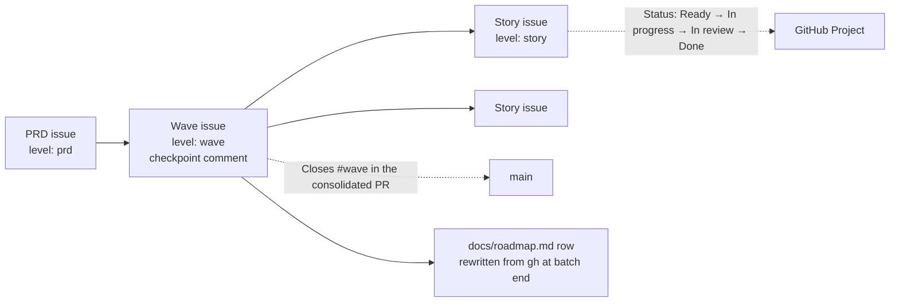

# PRD: projects-tracking — GitHub Projects as the execution status surface

## Changelog

| Version | Date       | Summary                                                                                                                                                                                      | Author                    |
| ------- | ---------- | -------------------------------------------------------------------------------------------------------------------------------------------------------------------------------------------- | ------------------------- |
| 1.0     | 2026-10-20 | Initial draft from the riel experiment (`llipe/riel`, `workstream/experiment-projects-campaign-ui.md`). Decisions D-01 to D-16 in `workstream/decisions-projects-tracking.md`; D-06 pending. | @llipe / product-engineer |

## Executive Summary

dev-tasks says GitHub is the source of truth for execution status, but gives GitHub no object to hold a PRD or a wave, no status that survives a forgotten label, and no committed checkpoint. A live experiment on one riel wave showed that a tracking-issue hierarchy with sub-issues, a Project Status written at steps agents already perform, a committed checkpoint, and a roadmap row rewritten from GitHub make the Project answer "what is in progress, what is next, what shipped" without any generated page. This PRD adopts those four pieces as toolkit conventions and parks the generated board (D-01).

## Feature Overview

Four changes, each small, each attached to a step that exists today:

1. **Hierarchy.** Publish creates one PRD tracking issue and one wave tracking issue, and attaches stories as sub-issues (D-02, D-03, D-04, D-05).
2. **Status.** When a Project is configured, a Status field is the only stage source; three agent writes keep it current, and the stage labels retire (D-06, D-07, D-08, D-09).
3. **Checkpoint.** The planner commits its state file on the integration branch and keeps one comment on the wave issue current (D-11, D-12).
4. **Roadmap.** The planner rewrites the wave's roadmap row from `gh` output at the batch boundary, and the consolidated PR closes the wave issue (D-13).

| Wave | Ships                                                                                                                                                                                                    |
| ---- | -------------------------------------------------------------------------------------------------------------------------------------------------------------------------------------------------------- |
| 1    | Conventions and hierarchy: github-ops rules, publish creates tracking issues and sub-issues, `docs/tech.md` Project section, activity-init setup step and runbook, developer Status writes, parity tests |
| 2    | Planner and verifier: committed checkpoint, in-place checkpoint comment, roadmap row rewritten from GitHub, `Closes #<wave>` in the consolidated PR, verifier rollup check, migration runbook            |

## Goals and Objectives

1. **GitHub holds the hierarchy.** Every PRD and wave published after this ships is an issue, and every story is a sub-issue of its wave. Measured by: the Project's Parent issue field is set on every story item.
2. **No stage lives in a label.** When a Project is configured, Status is written at three agent steps and never by hand. Measured by: no `status: ready` or `status: in-progress` label exists in a repository with a configured Project.
3. **The checkpoint is readable from GitHub.** Measured by: the wave issue's checkpoint comment names the current story and the last merged PR after every planner merge, and the state file is on the integration branch.
4. **The roadmap row cannot be written from memory.** Measured by: the planner's roadmap update cites the `gh` commands it derived the row from, in the consolidated PR body.
5. **Nothing breaks without a Project.** A repository with no `## GitHub Project` section behaves as today, plus the hierarchy, which needs no Project.

## Affected Repositories

| Repository        | Role / Impact                                                                                                                                                                                                                                                                                    |
| ----------------- | ------------------------------------------------------------------------------------------------------------------------------------------------------------------------------------------------------------------------------------------------------------------------------------------------ |
| `llipe/dev-tasks` | Sole repository. Changes github-ops, activity-publish-github, activity-init, developer, implement, planner and verifier across the three prompt trees; adds a `docs/tech.md` template section, two runbooks, and parity tests. No change to `core/` beyond a lint check for the tech.md section. |

Consumer repositories receive the conventions through the prompt trees. An existing consumer migrates with the wave 2 runbook; `llipe/riel` is the first.

## Target Users

- **Primary:** the developer running dev-tasks who wants the Project to answer what is in progress, what is next and what shipped, without opening workstream files.
- **Secondary:** the agents themselves, which today cannot find a wave's checkpoint on GitHub and cannot tell a story's stage from its labels.

## User Stories

1. As a developer, I want publish to create a PRD issue and a wave issue and attach the stories as sub-issues, so that the Project shows the hierarchy and a progress bar per wave with no extra work.
2. As a developer, I want a story's Project Status to move when the developer agent creates the branch and opens the PR, so that the board is right without anyone moving a label.
3. As a developer, I want the planner to commit its checkpoint and keep one comment on the wave issue current, so that I can see where a run stands from GitHub, including from my phone.
4. As a developer, I want the planner to rewrite the roadmap row from GitHub at the end of a batch, so that the roadmap stops claiming states that ended a day earlier.
5. As a developer, I want activity-init to set the Project up correctly, including turning off the automation that closes issues from a Status edit, so that an agent's write can never close real work.
6. As a maintainer of an existing consumer, I want a runbook to migrate my open waves into the hierarchy and retire the stage labels, so that riel can adopt this in one sitting.
7. As a developer with no Project, I want everything except the Status writes to work unchanged, so that the conventions do not force a Project on me.

## Functional Requirements

### Wave 1 — Conventions and hierarchy

- **FR-1.** github-ops gains two title forms: `[PRD-<name>] <PRD title>` for a PRD tracking issue and `[PRD-<name>] Wave <id>: <title>` for a wave tracking issue, where `<id>` is the phase number from the PRD's delivery table or a short name when the PRD has no numbered phases (D-04). The story form is unchanged.
- **FR-2.** github-ops gains a `level:` label category with `level: prd`, `level: wave`, `level: story`, one color family (D-03). `type:` keeps its meaning. Issues labeled `level: prd` or `level: wave` are exempt from the `type:` and `priority:` requirement (D-05).
- **FR-3.** activity-publish-github creates the PRD tracking issue if absent, the wave tracking issue, and the story issues, then links the wave under the PRD and each story under the wave with `POST /repos/{owner}/{repo}/issues/{n}/sub_issues` (D-02). The publication report gains the two tracking issue numbers. The "parent epic" clarifying question is removed; the hierarchy is not optional.
- **FR-4.** The wave tracking issue body carries: the wave's scope line from the PRD, the integration branch name once known, an Artifacts section linking the spec, story set, task plan and later the fidelity report by root-relative path, and the story list. No stage checkboxes (D-14).
- **FR-5.** `docs/tech.md` gains an optional `## GitHub Project` section with owner, project number and the Status option names (D-09). The lint checks that, when present, it carries all three. Absent section means no Project writes anywhere.
- **FR-6.** When the section is present: publish sets each new story's Status to Ready; developer sets In progress when it creates the story branch and In review when it opens the PR; Deferred is written only by product-engineer or the user (D-08). Each write is one `gh project item-edit` and is reported as `project_status: written(<value>)` or `failed(<reason>)`, never dropped silently.
- **FR-7.** The `status:` taxonomy retires `status: ready` and `status: in-progress` when a Project is configured, and keeps `status: blocked` and `status: needs-refinement` as flags. Without a Project the four labels stay as today (D-07).
- **FR-8.** activity-init's Repository Setup gains a recommended "GitHub Project" step with a runbook: create the Project, set the Status options Backlog, Ready, In progress, In review, Done, Deferred, set the auto-add filter to `is:issue`, keep the item-added, item-closed and item-reopened automations, turn off the auto-close-issue automation, delete the template's Priority, Size, Estimate and date fields, run `gh auth refresh -s project`, write the `docs/tech.md` section, and create the views by hand with the filters given (D-10).
- **FR-9.** activity-publish-github names `gh` as the primary surface and MCP as optional, matching CLAUDE.md (D-16).
- **FR-10.** Parity tests across the three prompt trees for FR-1, FR-2, FR-3, FR-6, FR-7 and FR-9.

### Wave 2 — Planner, verifier and migration

- **FR-11.** The planner commits `workstream/planner-state-<plan-id>.md` on the integration branch after every story merge, in the same step that writes it (D-11).
- **FR-12.** The planner posts one checkpoint comment on the wave issue at the first story merge and edits it in place after every later merge. It keeps the `🔄 Update:` prefix and references the wave issue. github-ops records that a designated checkpoint comment may be edited in place and every other comment is append-only (D-12).
- **FR-13.** At integration merge the planner closes the story issue with a `✅ Done:` comment naming the PR (D-06, pending). The Project's item-closed automation sets Done.
- **FR-14.** The planner's roadmap update derives the row's Status and Issues/PRs cells from `gh issue list` and `gh pr list` output, cites the commands in the consolidated PR body, and never writes a state it did not observe (D-13).
- **FR-15.** The consolidated PR body carries `Closes #<wave issue>` so the wave issue closes when the PR merges to main; story references stay `Refs` (D-13).
- **FR-16.** The verifier rollup audit compares the roadmap row with the wave issue and its sub-issues and reports a mismatch as an advisory finding, replacing the current roadmap-versus-merged-work comparison.
- **FR-17.** A migration runbook for an existing consumer: create the PRD and wave tracking issues for every open wave, attach existing stories as sub-issues, backfill Status from PR state, remove retired labels, and update the Project per FR-8. Ships in the same PR as the planner change.

## Business Rules

- The Project is read by humans and written by agents at three steps only. No agent ever sets Done directly; Done arrives through the issue closing (D-06, D-08).
- The auto-close-issue automation is off in every configured Project. A Status edit never closes an issue (D-10).
- A tracking issue is a container: no `type:`, no `priority:`, no assignee required (D-05).
- The roadmap row is derived at the batch boundary. A row written from memory is a defect the verifier reports (D-13).
- Without a `## GitHub Project` section, no agent runs a `gh project` command (D-09).

## Data Requirements

No new files beyond the two runbooks and the `docs/tech.md` section. GitHub holds the data:

| Entity         | Where                                    | Written by                                 |
| -------------- | ---------------------------------------- | ------------------------------------------ |
| PRD issue      | issue, `level: prd`                      | publish, once per PRD                      |
| Wave issue     | issue, `level: wave`, sub-issue of PRD   | publish, once per wave; planner edits body |
| Story issue    | issue, `level: story`, sub-issue of wave | publish                                    |
| Status         | Project single-select field              | publish, developer, product-engineer       |
| Checkpoint     | one comment on the wave issue, edited    | planner                                    |
| Project config | `docs/tech.md` `## GitHub Project`       | activity-init                              |

Sensitivity: nothing new. Tracking issues carry the same text as the PRD and stories already public to the repository.

## Non-Goals (Out of Scope)

- The generated board page and `dev-tasks board` command. `prd-factory-board.md` is parked (D-01).
- Stage checklists or a Stage field on wave issues (D-14).
- `needs:` labels (D-15).
- A Merged Status option. Shipping to main is a wave-level fact (D-06, pending).
- Milestones per wave. Milestones keep their `vX.Y` release meaning.
- Changing the integration branch naming rule. A wave issue records whatever branch the planner uses.
- Projects views created by automation. The API cannot; the runbook gives the filters.
- Organization-level issue types. `level:` labels stand in so user-owned repositories work.

## Design Considerations

No UI is built. The only user-facing surfaces are GitHub issues and the Project, configured per the runbook. The runbook names three views: a table grouped by Parent issue, a board by Status filtered to one wave, and a table filtered to `label:"status: blocked"`.

## Technical Considerations

- **Sub-issues.** REST, no scope beyond `repo`. A sub-issue needs the child's numeric id, read from `GET /repos/{o}/{r}/issues/{n}`.
- **Project writes.** `gh project item-edit` needs the `project` scope and the item id, read with `gh project item-list` or a GraphQL `fieldValues` query. The CLI's flattened item list drops custom fields; verification of a write reads GraphQL directly.
- **CI tokens.** A workflow's `GITHUB_TOKEN` cannot touch Projects. Nothing in this PRD runs from CI.
- **Comment editing.** `gh api -X PATCH /repos/{o}/{r}/issues/comments/{id}`. The planner records the comment id in the state file.
- **Alignment with SIMPLICITY.md.** No new `core/` module. The `docs/tech.md` section check joins the existing `core/checks/` pattern and returns findings.
- **Runbooks.** Wave 1 adds `docs/runbooks/runbook-configure-github-project.md`. Wave 2 adds `docs/runbooks/runbook-migrate-to-projects-tracking.md`, in the same PR as the planner change.

## Acceptance Criteria

- **AC-1.** Publishing a story set on a fixture PRD creates one PRD issue, one wave issue and N story issues, with the wave a sub-issue of the PRD and every story a sub-issue of the wave, proven by `GET .../sub_issues` (FR-3).
- **AC-2.** Both tracking issues carry `level:` labels and no `type:` or `priority:` label, and github-ops's label rule exempts them (FR-2).
- **AC-3.** With a `## GitHub Project` section present, the developer agent's branch-creation and PR-open steps each contain exactly one Status write and report it; with the section absent, neither step runs a `gh project` command (FR-5, FR-6).
- **AC-4.** The github-ops taxonomy no longer lists `status: ready` or `status: in-progress` as stage labels for a configured Project, and still lists `status: blocked` and `status: needs-refinement` (FR-7).
- **AC-5.** The activity-init runbook names every setting in FR-8, including the auto-close automation being off (FR-8).
- **AC-6.** activity-publish-github's execution-method rules name `gh` as primary (FR-9).
- **AC-7.** Three-tree parity for every changed prompt file (FR-10).
- **AC-8.** (wave 2) After a planner story merge on a fixture run, the integration branch carries the state file and the wave issue carries one checkpoint comment whose text names the merged PR; a second merge edits that comment rather than adding one (FR-11, FR-12).
- **AC-9.** (wave 2) The consolidated PR body contains `Closes #<wave>` and the `gh` commands the roadmap row was derived from (FR-14, FR-15).
- **AC-10.** (wave 2) The verifier rollup reports a roadmap row that disagrees with the wave issue's sub-issue states as an advisory finding (FR-16).
- **AC-11.** `pnpm run validate` passes.

## Success Metrics

- riel's next two batches run under these conventions with zero roadmap corrections after the fact.
- The riel Project answers "what is in progress" and "what is next" from its own views, with no generated page.
- No `status: ready` label remains on an open riel story after migration.

## Assumptions

- Consumers use `gh` authenticated as a user with `repo` and `project` scopes where a Project is configured.
- GitHub sub-issues and the REST endpoint for them remain available on user-owned repositories.
- The Project is a user or organization project the authenticated user can edit.

## Constraints and Dependencies

- `prd-factory-board.md` is parked, not cancelled. It depends on wave kinds, which this PRD does not define.
- Wave 2's migration runbook is exercised on `llipe/riel` before wave 2 is called Done.
- The runbook-in-same-PR rule (shared-understanding FR-49a) applies to both runbooks.

## Security and Compliance

- Agents write to the Project with the user's own token. No new credential.
- Turning off the auto-close automation is a hard requirement, because it is the only path by which a Status edit could close an issue (D-10).
- No change to merge authority. The planner still never merges to main.

## Open Questions

- **OQ-1 (D-06).** Confirm that a story's life ends at integration merge (Done when the planner closes it) and that shipping is tracked on the wave issue only, instead of the experiment's Merged option. The experiment's author recommended Merged; this PRD argues the repository already behaves the other way and the automation fights Merged.

## Candidate Stories

For `activity-generate-stories`, so the issue breakdown is mechanical. Each line is one candidate story; the skill validates coverage and may split or merge.

| ID    | Wave | Candidate story                                                                                      | Covers           |
| ----- | ---- | ---------------------------------------------------------------------------------------------------- | ---------------- |
| S-001 | 1    | github-ops: tracking-issue title forms, `level:` labels, priority exemption, checkpoint comment rule | FR-1, FR-2, D-12 |
| S-002 | 1    | activity-publish-github: create tracking issues, attach sub-issues, `gh` primary, report fields      | FR-3, FR-4, FR-9 |
| S-003 | 1    | `docs/tech.md` `## GitHub Project` section, template and lint check                                  | FR-5             |
| S-004 | 1    | developer and implement: Status writes at branch creation and PR open, reported                      | FR-6             |
| S-005 | 1    | Status label retirement with and without a Project                                                   | FR-7             |
| S-006 | 1    | activity-init Project setup step and `runbook-configure-github-project.md`                           | FR-8             |
| S-007 | 1    | Parity tests for S-001 to S-006                                                                      | FR-10            |
| S-008 | 2    | planner: commit the state file on the integration branch after every merge                           | FR-11            |
| S-009 | 2    | planner: in-place checkpoint comment on the wave issue, comment id in the state file                 | FR-12            |
| S-010 | 2    | planner: close story at integration merge, `Closes #<wave>` in the consolidated PR                   | FR-13, FR-15     |
| S-011 | 2    | planner: roadmap row derived from `gh` output, commands cited in the PR body                         | FR-14            |
| S-012 | 2    | verifier: rollup compares roadmap row with the wave issue                                            | FR-16            |
| S-013 | 2    | `runbook-migrate-to-projects-tracking.md`, exercised on riel                                         | FR-17            |

## Decisions

| ID   | Decision (short form)                                                               |
| ---- | ----------------------------------------------------------------------------------- |
| D-01 | Projects first; the generated board PRD is parked.                                  |
| D-02 | PRD issue, wave issue, stories as sub-issues, through REST.                         |
| D-03 | Hierarchy axis is `level:`, not `type:`.                                            |
| D-04 | Title forms for PRD and wave tracking issues.                                       |
| D-05 | Tracking issues are exempt from `type:` and `priority:`.                            |
| D-06 | Status model without Merged; shipping is a wave-level fact (pending).               |
| D-07 | Stage labels retire when a Project is configured; flags stay.                       |
| D-08 | Three Status writes: publish, branch creation, PR open.                             |
| D-09 | Project config lives in a `docs/tech.md` section.                                   |
| D-10 | Setup step and runbook in activity-init; auto-close automation off.                 |
| D-11 | Checkpoint file committed on the integration branch; one comment on the wave issue. |
| D-12 | A designated checkpoint comment may be edited in place.                             |
| D-13 | Roadmap row rewritten from `gh` output; consolidated PR closes the wave issue.      |
| D-14 | No stage checklist or Stage field now.                                              |
| D-15 | No `needs:` labels now.                                                             |
| D-16 | `gh` primary in activity-publish-github.                                            |

## Vocabulary

| Term               | Status in glossary | Bounded context                  | Definition (proposals only)                                                                                                                    | Forbidden synonyms (proposals only) |
| ------------------ | ------------------ | -------------------------------- | ---------------------------------------------------------------------------------------------------------------------------------------------- | ----------------------------------- |
| tracking issue     | proposed           | AI-assisted development workflow | A GitHub issue that stands for a PRD or a wave, labeled `level: prd` or `level: wave`, holding its sub-issues and, for a wave, its checkpoint. | epic, parent issue, umbrella issue  |
| checkpoint comment | proposed           | AI-assisted development workflow | The one comment on a wave tracking issue that the planner edits in place after every story merge to record the run's position.                 | status comment, progress comment    |
| roadmap drift      | existing           | AI-assisted development workflow |                                                                                                                                                |                                     |
| decision log       | existing           | AI-assisted development workflow |                                                                                                                                                |                                     |
| runbook            | existing           | AI-assisted development workflow |                                                                                                                                                |                                     |
