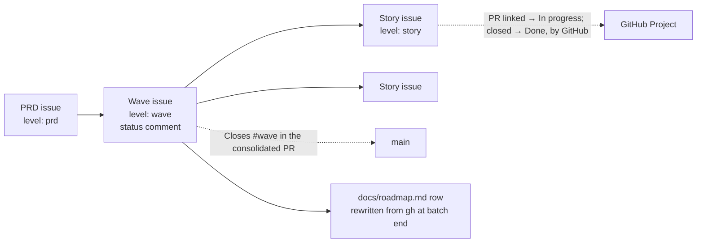

# PRD: projects-tracking — GitHub Projects as the execution status surface

## Changelog

| Version | Date       | Summary                                                                                                                                                                                                                                                                                                                                                                                                                                                                                                                                                                                       | Author                    |
| ------- | ---------- | --------------------------------------------------------------------------------------------------------------------------------------------------------------------------------------------------------------------------------------------------------------------------------------------------------------------------------------------------------------------------------------------------------------------------------------------------------------------------------------------------------------------------------------------------------------------------------------------- | ------------------------- |
| 1.11    | 2026-10-24 | Wave 3 Design Mode resolutions confirmed by @llipe: FR-18 drops the milestone rule and scopes `phase:` to the title's PRD (D-98); AC-11's fixture keeps a milestone-only story unmapped; AC-13 amended, state files listed and filled by the planner's resume (D-99); FR-17 says "migration plan" (A-92).                                                                                                                                                                                                                                                                                     | @llipe / product-engineer |
| 1.10    | 2026-10-23 | Wave 3 HOW phase (D-79 to D-96), confirmed by @llipe: FR-17 becomes a `migrate projects` CLI with a github-ops conversation (D-79); FR-19 defines a story (D-82); FR-20's Project cleanup is a batch the user runs and retired label definitions are kept (D-81, D-91); FR-22 drops the riel dependency, riel becomes the post-delivery test bed (D-94); FR-26 and AC-16 add the `type:` set, priority scale and `**Blocks:**` convention (D-83 to D-85); S-013, S-015 to S-017 re-scoped, S-019 added; three vocabulary proposals.                                                           | @llipe / product-engineer |
| 1.9     | 2026-10-22 | Wave 2 rollup follow-ups (#305, #307, #308, #310, #311): FR-12 gains the closeout-edit merge gate (D-71, RD-1); FR-14 states `Done` needs every story issue closed (D-72, RD-8); Project reads need `read:project`, recorded as `not observed` without it (RD-6, taken from GitHub's documented scope model and not yet exercised with a token that lacks the scope); the last "wave 2 runbook" sentence moves to wave 3 (RD-3); pre-hierarchy waves keep a PRD status row with `—` (D-73, RD-12); resolved follow-ups close through the consolidated PR (D-74, observed on #285 by PR #312). | @llipe / product-engineer |
| 1.8     | 2026-10-22 | Wave 2 rollup RD-3: the migration runbook belongs to wave 3 (FR-22), not wave 2; Technical Considerations corrected.                                                                                                                                                                                                                                                                                                                                                                                                                                                                          | planner                   |
| 1.7     | 2026-10-22 | FR-16 wording: the wave-issue comparison takes precedence, merged PRs remain the fallback (Design Mode A-28, D-57), confirmed by @llipe.                                                                                                                                                                                                                                                                                                                                                                                                                                                      | product-engineer          |
| 1.6     | 2026-10-21 | Rollup audit R-1 (fidelity-report-projects-tracking-phase-1-rollup): FR-6 corrected. GitHub links a pull request to an issue only when the PR's base is the default branch, so under the planner Status moves at the consolidated PR, not at the story PR; in-flight state is the status comments (D-50).                                                                                                                                                                                                                                                                                     | product-engineer          |
| 1.5     | 2026-10-21 | Write-back from the Project 5 exercise and the wave 1 audits: FR-6 drops the nonexistent "item reopened" workflow (D-47); FR-8 accepts either template and makes the field cleanup optional (D-46, D-48); Security states Auto-close ships enabled and is left as shipped (D-45). No requirement changed in substance.                                                                                                                                                                                                                                                                        | product-engineer          |
| 1.4     | 2026-10-20 | Design Mode findings A-5 and A-18 confirmed by @llipe as intended: Security section no longer says agents write to the Project or that auto-close must be turned off; stale `docs/tech.md` section mentions removed. No requirement changed.                                                                                                                                                                                                                                                                                                                                                  | product-engineer          |
| 1.3     | 2026-10-20 | Approved by @llipe. Vocabulary rows flipped to `existing` after the glossary append (ubiquitous-language v1.3).                                                                                                                                                                                                                                                                                                                                                                                                                                                                               | @llipe / product-engineer |
| 1.2     | 2026-10-20 | Native status model (D-22 to D-24): no agent writes Project Status; GitHub's own automations move it and `Closes` on the consolidated PR closes stories and the wave at ship. OQ-1 resolved. Mandatory status comments on story, wave and PRD issues, edited in place (D-25, D-26, FR-23 to FR-25). FR-5 withdrawn; FR-6, FR-7, FR-8, FR-12, FR-13, FR-15, FR-20, FR-21 rewritten. Re-lands the v1.1 table rows that prettier padding dropped.                                                                                                                                                | @llipe / product-engineer |
| 1.1     | 2026-10-20 | Migration becomes wave 3 with its own requirements (FR-17 to FR-22, D-17 to D-21): dry-run plan, mapping precedence, rules for closed waves, standalone issues and titles, roadmap conversion, document backfill, adoption order.                                                                                                                                                                                                                                                                                                                                                             | @llipe / product-engineer |
| 1.0     | 2026-10-20 | Initial draft from the riel experiment (`llipe/riel`, `workstream/experiment-projects-campaign-ui.md`). Decisions D-01 to D-16 in `workstream/decisions-projects-tracking.md`; D-06 pending.                                                                                                                                                                                                                                                                                                                                                                                                  | @llipe / product-engineer |

## Executive Summary

dev-tasks says GitHub is the source of truth for execution status, but gives GitHub no object to hold a PRD or a wave, no status that survives a forgotten label, and no committed checkpoint. A live experiment on one riel wave showed that a tracking-issue hierarchy with sub-issues, a Project Status written at steps agents already perform, a committed checkpoint, and a roadmap row rewritten from GitHub make the Project answer "what is in progress, what is next, what shipped" without any generated page. This PRD adopts those four pieces as toolkit conventions and parks the generated board (D-01). Status itself is never written by an agent: GitHub's own Project automations move it, and the consolidated PR's `Closes` lines close every story and the wave when they reach main (D-22). What agents write is a status comment on the story, the wave and the PRD issue, one per issue, edited in place at events that already exist (D-25).

## Feature Overview

Four changes, each small, each attached to a step that exists today:

1. **Hierarchy.** Publish creates one PRD tracking issue and one wave tracking issue, and attaches stories as sub-issues (D-02, D-03, D-04, D-05).
2. **Status.** The Project's Status is GitHub's own: the first option on add, In progress when a pull request against the default branch references the issue, Done when the issue closes. No agent writes it. Stories close when the consolidated PR merges to main with `Closes #N` for each, so Done means on main. The stage labels retire everywhere (D-22, D-23, D-07).
3. **Status comments.** One designated, marker-identified comment per story, wave and PRD issue, edited in place by the agent that owns the event: the developer at every sub-task, PR open and gate; the planner at story start, closeout, merge and block; the planner and product-engineer at wave events on the PRD issue. The planner also commits its state file on the integration branch (D-11, D-12, D-25, D-26).
4. **Roadmap.** The planner rewrites the wave's roadmap row from `gh` output at the batch boundary, and the consolidated PR closes the wave issue (D-13).

| Wave | Ships                                                                                                                                                                                                          |
| ---- | -------------------------------------------------------------------------------------------------------------------------------------------------------------------------------------------------------------- |
| 1    | Conventions and hierarchy: github-ops rules, publish creates tracking issues and sub-issues, activity-init setup step and runbook, mandatory story status comment in implement, label retirement, parity tests |
| 2    | Planner and verifier: committed checkpoint, wave and PRD status comments, planner never closes stories, `Closes` for every story and the wave in the consolidated PR, roadmap row from `gh`, verifier check    |
| 3    | Migration of an existing repository: github-ops migration mode with an approved dry-run plan, mapping precedence, roadmap conversion, document backfill, runbook; dev-tasks first, then riel                   |

## Goals and Objectives

1. **GitHub holds the hierarchy.** Every PRD and wave published after this ships is an issue, and every story is a sub-issue of its wave. Measured by: the Project's Parent issue field is set on every story item.
2. **No stage lives in a label, and no agent writes Status.** Measured by: no `status: ready` or `status: in-progress` label exists after migration, and no prompt file contains a `gh project item-edit` command.
3. **Current status is readable from GitHub before any merge.** Measured by: the story issue's status comment names the sub-task in progress and the PR; the wave issue's status comment names the current story and what is merged into integration; the state file is on the integration branch.
4. **The roadmap row cannot be written from memory.** Measured by: the planner's roadmap update cites the `gh` commands it derived the row from, in the consolidated PR body.
5. **Nothing breaks without a Project.** The hierarchy, the status comments and the closing rules need no Project at all; a Project only displays them.

## Affected Repositories

| Repository        | Role / Impact                                                                                                                                                                                                                                                |
| ----------------- | ------------------------------------------------------------------------------------------------------------------------------------------------------------------------------------------------------------------------------------------------------------ |
| `llipe/dev-tasks` | Sole repository. Changes github-ops, activity-publish-github, activity-init, developer, implement, planner and verifier across the three prompt trees; adds two runbooks and parity tests. No change to `core/` beyond a lint check for the tech.md section. |

Consumer repositories receive the conventions through the prompt trees. An existing consumer migrates with the wave 3 runbook (FR-22); `llipe/riel` is the first.

## Target Users

- **Primary:** the developer running dev-tasks who wants the Project to answer what is in progress, what is next and what shipped, without opening workstream files.
- **Secondary:** the agents themselves, which today cannot find a wave's checkpoint on GitHub and cannot tell a story's stage from its labels.

## User Stories

1. As a developer, I want publish to create a PRD issue and a wave issue and attach the stories as sub-issues, so that the Project shows the hierarchy and a progress bar per wave with no extra work.
2. As a developer, I want the Project's Status to move by GitHub's own automations when a PR is linked and when the issue closes at ship, so that no agent and no label can make it wrong.
3. As a developer, I want one status comment on the story, the wave and the PRD issue, updated in place as work happens and before any merge, so that I can see where a run stands from GitHub, including from my phone, without reading a workstream file.
4. As a developer, I want the planner to rewrite the roadmap row from GitHub at the end of a batch, so that the roadmap stops claiming states that ended a day earlier.
5. As a developer, I want activity-init to set the Project up with GitHub's default automations kept and only the noise removed, so that setup is a few minutes and nothing fights GitHub.
6. As a maintainer of an existing consumer, I want a migration mode that shows me every write it intends before it makes one, maps my issues to waves by rules I can read, and tells me which it could not map, so that riel adopts this in one approved sitting.
7. As a developer with no Project, I want everything except the Status writes to work unchanged, so that the conventions do not force a Project on me.

## Functional Requirements

### Wave 1 — Conventions and hierarchy

- **FR-1.** github-ops gains two title forms: `[PRD-<name>] <PRD title>` for a PRD tracking issue and `[PRD-<name>] Wave <id>: <title>` for a wave tracking issue, where `<id>` is the phase number from the PRD's delivery table or a short name when the PRD has no numbered phases (D-04). The story form is unchanged.
- **FR-2.** github-ops gains a `level:` label category with `level: prd`, `level: wave`, `level: story`, one color family (D-03). `type:` keeps its meaning. Issues labeled `level: prd` or `level: wave` are exempt from the `type:` and `priority:` requirement (D-05).
- **FR-3.** activity-publish-github creates the PRD tracking issue if absent, the wave tracking issue, and the story issues, then links the wave under the PRD and each story under the wave with `POST /repos/{owner}/{repo}/issues/{n}/sub_issues` (D-02). The publication report gains the two tracking issue numbers. The "parent epic" clarifying question is removed; the hierarchy is not optional.
- **FR-4.** The wave tracking issue body carries: the wave's scope line from the PRD, the integration branch name once known, an Artifacts section linking the spec, story set, task plan and later the fidelity report by root-relative path, and the story list. No stage checkboxes (D-14).
- **FR-5.** Withdrawn in v1.2 (D-24). No agent needs the Project's identity, because no agent writes to it.
- **FR-6.** No agent writes Project Status. The Project keeps GitHub's default automations: item added sets the template's first Status option (Todo or Backlog), a linked pull request sets In progress, item closed sets Done; there is no shipped "item reopened" workflow (D-47). GitHub creates the closing link, and fires the linked-pull-request automation, only for a pull request whose base is the default branch (D-50). A story PR into an integration branch carries `Closes #N` for the record but moves nothing; under the planner the story's Status stays at the first option until the consolidated PR to main opens with `Closes #N` for every story and `Closes #<wave>`, which moves them to In progress, and merges, which closes them at ship (D-22, D-23). A main-thread `/developer` PR against the default branch links at open. In-flight state under the planner lives in the status comments, not in Status (D-25). The first Status option means ready by construction, since published stories are refined; `status: needs-refinement` marks the exception.
- **FR-7.** The `status:` taxonomy retires `status: ready` and `status: in-progress` everywhere, Project or not, since a linked pull request shows the same fact natively on the issue. `status: blocked`, `status: needs-refinement` and `status: deferred` stay as flags (D-07, D-22).
- **FR-8.** activity-init's Repository Setup gains a recommended "GitHub Project" step with a runbook: create the Project from the Board or the Team planning template, keep its Status options and GitHub's default automations as shipped, narrow the auto-add filter to `is:issue`, optionally delete the Team planning template's Priority, Size, Estimate and date fields, and create three views by hand with the filters given: a table grouped by Parent issue, a board by Status filtered to one wave, and a table filtered to `label:"status: blocked"` (D-10, D-22, D-46, D-48).
- **FR-9.** activity-publish-github names `gh` as the primary surface and MCP as optional, matching CLAUDE.md (D-16).
- **FR-10.** Parity tests across the three prompt trees for FR-1, FR-2, FR-3, FR-7, FR-9 and FR-23.
- **FR-23.** The story issue carries one status comment, mandatory, created by the developer at the first sub-task and edited in place at every sub-task completion, at PR open, at each gate recorded (`coverage_gate`, verifier verdict), and on block. It carries a fixed table: sub-tasks done of total with the current one named, branch, PR, gates, blocker, last-updated time. It replaces implement's optional free-form progress comments; the issue checklist sync stays as it is (D-25). A designated comment is found by its marker `<!-- dev-tasks:status -->` on every edit, so no comment id is stored anywhere (D-26).
- **FR-24.** When the developer runs in the main thread with no planner, it resolves the story's parent with `GET /repos/{o}/{r}/issues/{n}/parent` and updates the wave's status comment itself at PR open and PR ready; under the planner, the planner owns the wave comment and the developer touches only the story's (D-25).

### Wave 2 — Planner and verifier

- **FR-11.** The planner commits `workstream/planner-state-<plan-id>.md` on the integration branch after every story merge, in the same step that writes it (D-11).
- **FR-12.** The planner keeps the wave issue's status comment current: created at run start, edited in place at every story start, every developer closeout, every integration merge and every block. It lists each story with its state (pending, in progress with sub-task n of m, PR open, merged into integration, blocked), the current story, the last merged PR, the integration branch HEAD, and the gates recorded so far. github-ops records that a designated status comment is edited in place and every other comment is append-only (D-12, D-25, D-26). The developer-closeout edit is made before the merge gates, never folded into the merge edit, and merge gate 10 holds the merge until the story reads `PR open` (D-71).
- **FR-13.** The planner never closes a story issue. At integration merge it updates the wave's status comment and the state file; the issue closes when the consolidated PR merges to main (D-22). developer and implement keep their "never close early" rules, with "merged" defined as merged to main.
- **FR-14.** The planner's roadmap update derives the row's Status and Issues/PRs cells from `gh issue list` and `gh pr list` output, cites the commands in the consolidated PR body, and never writes a state it did not observe (D-13). At close-out the row reads `Done` only when every story merged, every story issue is closed and the wave issue is closed; a merged story whose issue stayed open keeps the row `In progress` with `#N open (missed Closes keyword)` in What's missing (D-72).
- **FR-15.** The consolidated PR body carries `Closes #N` for every story the run merged and `Closes #<wave issue>`, generated from the planner's state table, so every story and the wave close when the PR merges to main; github-ops's "Closes or Refs" rule gains this case (D-13, D-22).
- **FR-16.** The verifier rollup audit compares the roadmap row with the wave issue and its sub-issues and reports a mismatch as an advisory finding, taking precedence over the roadmap-versus-merged-work comparison, which remains the fallback when a wave has no tracking issue (D-57).
- **FR-25.** The PRD issue carries one status comment listing every wave with its state and a link to its wave issue, edited in place at wave events only: product-engineer when a wave is published, the planner when a run starts, when the consolidated PR opens, and when it merges. The wave issue body's Artifacts section is updated by the agent that produces an artifact: product-engineer for the task plan, the planner for the fidelity report (D-25).
- **FR-26.** (wave 3) Label conventions the migration enforces. Every issue carries exactly one `type:` label from `enhancement`, `bug`, `security`, `refactor`, `test`, `docs`, `chore`, `tech-debt`, with a tie-break order; `type: other` retires (D-85). `priority: critical` means the issue blocks a wave, PRD or release from shipping and carries a native GitHub `blocked by` relation from the issue it blocks plus a `**Blocks:** #N — <reason>` body line; any issue that blocks another carries that line (D-84). Follow-ups, bugs and release blockers are aggregated by these labels and by the `Follow-up to #N` body line, with no new label category (D-83).

### Wave 3 — Migration of an existing repository

- **FR-17.** Migration is a CLI command with a github-ops conversation around it (D-79). `dev-tasks migrate projects --plan` reads the repository through `gh` and writes a migration plan to `workstream/migration-projects.md`, writing nothing to GitHub. The plan lists every proposed write grouped into batches (labels, tracking issues, sub-issue links, story and type labels, label removals, status comments, and a Project cleanup batch the user runs), and the items that need the user's answer: unmapped issues, issues that need a type, and critical issues that need a blocking link. `--apply` runs only a plan the user approved, records each write's state in the plan, and resumes on a re-run (D-17, D-79, D-80, D-88).
- **FR-18.** An existing story maps to its wave by this precedence: the `**Story:** workstream/user-stories-<slug>-phase-<N>.md` body line; else a `phase:` label resolved against the roadmap rows of the PRD named in the story's title prefix; else unmapped. Unmapped issues are never guessed; they wait for the user (D-18, D-98).
- **FR-19.** Scope rules: one PRD tracking issue per PRD file; a wave tracking issue only for a wave with at least one open story or an active planner run; no tracking issue for a shipped wave, whose roadmap row remains its record; no `level:` label and no parent on standalone bugs and chores; existing titles are never changed, since the sub-issue link carries the hierarchy and the title forms apply to new issues (D-19). A story is an open issue whose title carries `Story S-NNN` or whose body has the `**Story:**` line; every other issue, follow-ups included, is standalone and keeps its `phase:` label as a filter (D-82).
- **FR-20.** Migration removes the retired labels from every open issue and keeps their definitions, marked retired (D-91). The Project cleanup is a batch the user runs: removing pull-request items from the Project, narrowing the auto-add filter to `is:issue`, and restoring the default automations where a template changed them; no agent writes the Project (D-81, D-22). No Status is backfilled: GitHub's automations already reflect linked PRs and closed issues (D-27).
- **FR-21.** Document backfill: `docs/roadmap.md` is converted to the canonical table (one row per PRD phase or wave, Status from the fixed set, Issues/PRs naming the wave tracking issue) with any existing narrative kept below the table; every active `planner-state-*.md` gains a `Wave issue: #N` line, and the state-file format in the planner gains the same line (D-21, D-26). Publication reports are history and stay unchanged.
- **FR-22.** `docs/runbooks/runbook-migrate-to-projects-tracking.md` documents the command and the conversation and ships in the same PR. This repository migrates with it; wave 3 is Done when its consolidated PR merges. `llipe/riel` is the owner's test bed after delivery, outside this wave; what it finds returns as follow-up issues (D-94).

## Business Rules

- No agent writes Project Status, ever. GitHub's automations move it; `Closes` lines on the consolidated PR close stories and the wave at ship (D-22, D-23).
- A story or wave issue is closed by GitHub at ship, never by an agent. Deferred work is flagged with `status: deferred`, not closed (D-22).
- A tracking issue is a container: no `type:`, no `priority:`, no assignee required (D-05).
- The roadmap row is derived at the batch boundary. A row written from memory is a defect the verifier reports (D-13).
- No prompt file contains a `gh project` write command. Project setup is the runbook's job, once (D-24).
- Every status comment is one designated comment per issue, found by its marker and edited in place. Status updates never accumulate as new comments (D-25, D-26).
- Migration never guesses: an issue it cannot map by FR-18 is listed for the user, and no existing title is changed (D-18, D-19).

## Data Requirements

No new files beyond the two runbooks. GitHub holds the data:

| Entity         | Where                                            | Written by                                       |
| -------------- | ------------------------------------------------ | ------------------------------------------------ |
| PRD issue      | issue, `level: prd`                              | publish, once per PRD                            |
| Wave issue     | issue, `level: wave`, sub-issue of PRD           | publish, once per wave; planner edits body       |
| Story issue    | issue, `level: story`, sub-issue of wave         | publish                                          |
| Status         | Project single-select field                      | GitHub automations only                          |
| Status comment | one marked comment per story, wave and PRD issue | developer; planner; planner and product-engineer |

Sensitivity: nothing new. Tracking issues carry the same text as the PRD and stories already public to the repository.

## Non-Goals (Out of Scope)

- The generated board page and `dev-tasks board` command. `prd-factory-board.md` is parked (D-01).
- Stage checklists or a Stage field on wave issues (D-14).
- `needs:` labels (D-15).
- Any agent-written Project Status, including a Merged or In review option. A linked pull request shows open or merged natively; Done means on main (D-22).
- Closing a story at integration merge. GitHub closes it at ship (D-22).
- Milestones per wave. Milestones keep their `vX.Y` release meaning.
- Changing the integration branch naming rule. A wave issue records whatever branch the planner uses.
- Projects views created by automation. The API cannot; the runbook gives the filters.
- Organization-level issue types. `level:` labels stand in so user-owned repositories work.

## Design Considerations

No UI is built. The only user-facing surfaces are GitHub issues and the Project, configured per the runbook. The runbook names three views: a table grouped by Parent issue, a board by Status filtered to one wave, and a table filtered to `label:"status: blocked"`.

## Technical Considerations

- **Sub-issues.** REST, no scope beyond `repo`. A sub-issue needs the child's numeric id, read from `GET /repos/{o}/{r}/issues/{n}`.
- **Project writes.** None by agents. The `project` scope is needed only by the person running the setup runbook.
- **Project reads.** The planner's read-only Status observation (`gh issue view <n> --json projectItems`) works only with the `read:project` scope, which `project` includes and a default `gh` login lacks. Without it the observation records `not observed(missing read:project scope)` and nothing else changes (RD-6).
- **CI tokens.** A workflow's `GITHUB_TOKEN` cannot touch Projects. Nothing in this PRD runs from CI.
- **Comment editing.** `gh api /repos/{o}/{r}/issues/{n}/comments` to find the comment carrying `<!-- dev-tasks:status -->`, then `gh api -X PATCH /repos/{o}/{r}/issues/comments/{id}`. No id is stored; the marker is the identity (D-26).
- **Alignment with SIMPLICITY.md.** No new `core/` module and no new check. Every change is prompt text and tests.
- **Runbooks.** Wave 1 adds `docs/runbooks/runbook-configure-github-project.md`. Wave 3 adds `docs/runbooks/runbook-migrate-to-projects-tracking.md`, in the same PR as the migration mode (FR-22).

## Acceptance Criteria

- **AC-1.** Publishing a story set on a fixture PRD creates one PRD issue, one wave issue and N story issues, with the wave a sub-issue of the PRD and every story a sub-issue of the wave, proven by `GET .../sub_issues` (FR-3).
- **AC-2.** Both tracking issues carry `level:` labels and no `type:` or `priority:` label, and github-ops's label rule exempts them (FR-2).
- **AC-3.** No prompt file in any tree contains a `gh project item-edit` or `gh project item-add` command, proven by a test; the story issue in the fixture run carries exactly one comment with the status marker after three sub-tasks and a PR open, and its table names sub-task 3 of N and the PR (FR-6, FR-23).
- **AC-4.** The github-ops taxonomy no longer lists `status: ready` or `status: in-progress`, and lists `status: blocked`, `status: needs-refinement` and `status: deferred` as flags (FR-7).
- **AC-5.** The activity-init runbook names every setting in FR-8 and contains no instruction to change a default automation (FR-8).
- **AC-6.** activity-publish-github's execution-method rules name `gh` as primary (FR-9).
- **AC-7.** Three-tree parity for every changed prompt file (FR-10).
- **AC-8.** (wave 2) In a fixture planner run, the wave issue carries exactly one comment with the status marker after story start, closeout, merge and a second story start, its table showing the first story as merged into integration and the second as in progress, and the integration branch carries the state file after each merge (FR-11, FR-12).
- **AC-9.** (wave 2) The consolidated PR body contains `Closes #N` for every merged story and `Closes #<wave>`, plus the `gh` commands the roadmap row was derived from; no story issue was closed before that PR merged (FR-13, FR-14, FR-15).
- **AC-10.** (wave 2) The verifier rollup reports a roadmap row that disagrees with the wave issue's sub-issue states as an advisory finding (FR-16).
- **AC-11.** (wave 3) On a fixture repository with one PRD, two waves, six stories (two linked by body line, two by `phase:` label, one linked only by a milestone, one unmappable) and one standalone bug, the dry-run plan lists exactly the writes FR-19 permits, names the milestone-only and the unmappable stories as unmapped, proposes no title change and no parent for the bug, and nothing on GitHub changes before approval (FR-17, FR-18, FR-19).
- **AC-12.** (wave 3) After the approved run, no open issue in the fixture carries a retired label, the Project holds no pull-request item, and no Status was written by the migration (FR-20).
- **AC-13.** (wave 3) The fixture's roadmap passes the roadmap-parity test, and the plan lists every active planner-state file that lacks the `Wave issue` line; the planner's resume adds it (FR-21, D-89, D-99).
- **AC-15.** (wave 2) The PRD issue in the fixture carries exactly one comment with the status marker after a wave is published and a run starts, listing the wave with its state (FR-25).
- **AC-16.** (wave 3) The three github-ops copies state the `type:` set and tie-break, the priority scale, the `**Blocks:**` line and the dependency commands identically, and the github-ops audit reports a `critical` issue without a blocking relation, an issue with zero or several `type:` labels, and a retired label on an open issue (FR-26).
- **AC-14.** `pnpm run validate` passes.

## Success Metrics

- riel's next two batches run under these conventions with zero roadmap corrections after the fact.
- The riel Project answers "what is in progress" and "what is next" from its own views, with no generated page.
- No `status: ready` label remains on an open riel story after migration, and the migration plan's unmapped list for riel is resolved by the owner, not guessed.

## Assumptions

- Consumers use `gh` authenticated with the `repo` scope. The `project` scope is needed once, by the person running the setup runbook; `read:project` is optional and only enables the planner's Status observation.
- GitHub sub-issues and the REST endpoint for them remain available on user-owned repositories.
- The Project is a user or organization project the authenticated user can edit.

## Constraints and Dependencies

- `prd-factory-board.md` is parked, not cancelled. It depends on wave kinds, which this PRD does not define.
- Wave 3 is exercised on this repository and is Done when its consolidated PR merges; `llipe/riel` is the owner's test bed afterwards, with no dependency from this wave (FR-22, D-94).
- The runbook-in-same-PR rule (shared-understanding FR-49a) applies to both runbooks.

## Security and Compliance

- No agent writes to the Project. Agents read and write issues and comments with the user's own `gh` login; no new credential.
- The Project's Auto-close issue automation ships enabled and is left as shipped; since no agent writes Status (D-23), it can only fire on a human's Status change. The runbook records the automation names and states it observes (D-22, D-43, D-45).
- No change to merge authority. The planner still never merges to main.

## Open Questions

None. OQ-1 was resolved by D-22: Status is GitHub-native, stories close at ship, and the Merged question disappears.

## Candidate Stories

For `activity-generate-stories`, so the issue breakdown is mechanical. Each line is one candidate story; the skill validates coverage and may split or merge.

| ID    | Wave | Candidate story                                                                                                        | Covers           |
| ----- | ---- | ---------------------------------------------------------------------------------------------------------------------- | ---------------- |
| S-001 | 1    | github-ops: tracking-issue title forms, `level:` labels, priority exemption, status-comment edit rule                  | FR-1, FR-2, D-12 |
| S-002 | 1    | activity-publish-github: create tracking issues, attach sub-issues, `gh` primary, report fields                        | FR-3, FR-4, FR-9 |
| S-003 | 1    | implement and developer: mandatory story status comment, marker, events, fixed table                                   | FR-23, FR-24     |
| S-004 | 1    | github-ops and publish: no agent Status writes, `Closes` rules, status-comment edit rule                               | FR-6, FR-12 rule |
| S-005 | 1    | Stage label retirement everywhere; `status: deferred` added as a flag                                                  | FR-7             |
| S-006 | 1    | activity-init Project setup step and `runbook-configure-github-project.md`                                             | FR-8             |
| S-007 | 1    | Parity tests for S-001 to S-006                                                                                        | FR-10            |
| S-008 | 2    | planner: commit the state file on the integration branch after every merge                                             | FR-11            |
| S-009 | 2    | planner: wave status comment at run start, story start, closeout, merge and block                                      | FR-12            |
| S-010 | 2    | planner: never close stories; `Closes` for every story and the wave in the consolidated PR                             | FR-13, FR-15     |
| S-011 | 2    | planner: roadmap row derived from `gh` output, commands cited in the PR body                                           | FR-14            |
| S-012 | 2    | verifier: rollup compares roadmap row with the wave issue                                                              | FR-16            |
| S-018 | 2    | planner and product-engineer: PRD status comment at wave events; Artifacts section updates                             | FR-25            |
| S-013 | 3    | `migrate projects --plan`: snapshot, classification, plan file, review lists, approval header                          | FR-17, FR-26     |
| S-014 | 3    | Mapping precedence and the unmapped list; scope rules for closed waves, standalone issues, titles                      | FR-18, FR-19     |
| S-015 | 3    | `migrate projects --apply`: approved batches, write states, resume; retired labels; Project batch printed for the user | FR-17, FR-20     |
| S-016 | 3    | product-engineer roadmap conversion before migration; state files listed, not edited (D-86, D-89)                      | FR-21            |
| S-017 | 3    | Migration runbook and github-ops migration mode; this repository migrated with it                                      | FR-22            |
| S-019 | 3    | github-ops ×3: `type:` set, priority scale, `**Blocks:**` line, dependency commands, audit checks                      | FR-26            |

## Decisions

| ID   | Decision (short form)                                                                          |
| ---- | ---------------------------------------------------------------------------------------------- |
| D-01 | Projects first; the generated board PRD is parked.                                             |
| D-02 | PRD issue, wave issue, stories as sub-issues, through REST.                                    |
| D-03 | Hierarchy axis is `level:`, not `type:`.                                                       |
| D-04 | Title forms for PRD and wave tracking issues.                                                  |
| D-05 | Tracking issues are exempt from `type:` and `priority:`.                                       |
| D-06 | Superseded by D-22.                                                                            |
| D-07 | Stage labels retire when a Project is configured; flags stay.                                  |
| D-08 | Superseded by D-23.                                                                            |
| D-09 | Superseded by D-24.                                                                            |
| D-10 | Setup step and runbook in activity-init.                                                       |
| D-11 | Checkpoint file committed on the integration branch; one comment on the wave issue.            |
| D-12 | A designated status comment may be edited in place.                                            |
| D-13 | Roadmap row rewritten from `gh` output; consolidated PR closes the wave issue.                 |
| D-14 | No stage checklist or Stage field now.                                                         |
| D-15 | No `needs:` labels now.                                                                        |
| D-16 | `gh` primary in activity-publish-github.                                                       |
| D-17 | Migration is an approval-gated github-ops mode with a dry-run plan file.                       |
| D-18 | Mapping precedence: body story line, `phase:` label, milestone, else unmapped.                 |
| D-19 | No tracking issue for shipped waves; no hierarchy on standalone issues; titles unchanged.      |
| D-20 | Superseded by D-27.                                                                            |
| D-21 | Roadmap converted to the canonical table; planner-state backfilled.                            |
| D-22 | Native status model: GitHub automations move Status; `Closes` at ship closes stories and wave. |
| D-23 | No agent writes Project Status.                                                                |
| D-24 | No `docs/tech.md` Project section; no agent needs the Project's identity.                      |
| D-25 | One mandatory status comment per story, wave and PRD issue, edited in place at events.         |
| D-26 | Status comments are identified by a marker, not a stored id.                                   |
| D-27 | Migration backfills no Status; it removes retired labels and PR items only.                    |

## Vocabulary

| Term             | Status in glossary | Bounded context                  | Definition (proposals only)                                                                                                                     | Forbidden synonyms (proposals only)                  |
| ---------------- | ------------------ | -------------------------------- | ----------------------------------------------------------------------------------------------------------------------------------------------- | ---------------------------------------------------- |
| tracking issue   | existing           | AI-assisted development workflow | A GitHub issue that stands for a PRD or a wave, labeled `level: prd` or `level: wave`, holding its sub-issues and its status comment.           | epic, parent issue, umbrella issue                   |
| status comment   | existing           | AI-assisted development workflow | The one marker-identified comment on a story, wave or PRD issue that the owning agent edits in place at defined events to record current state. | progress comment, checkpoint comment, update comment |
| roadmap drift    | existing           | AI-assisted development workflow |                                                                                                                                                 |                                                      |
| decision log     | existing           | AI-assisted development workflow |                                                                                                                                                 |                                                      |
| runbook          | existing           | AI-assisted development workflow |                                                                                                                                                 |                                                      |
| migration plan   | existing           | AI-assisted development workflow |                                                                                                                                                 |                                                      |
| standalone issue | existing           | AI-assisted development workflow |                                                                                                                                                 |                                                      |
| release blocker  | existing           | AI-assisted development workflow |                                                                                                                                                 |                                                      |
