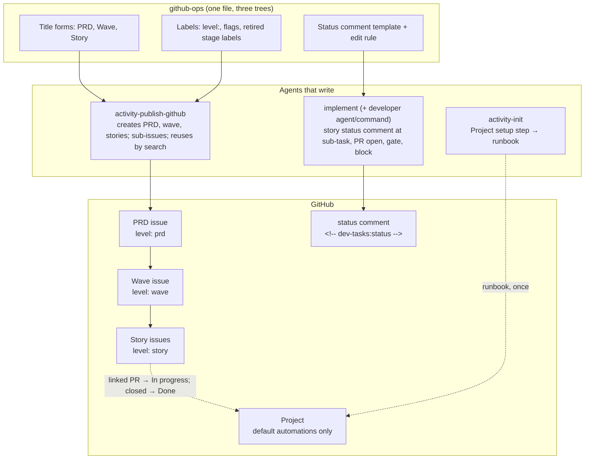
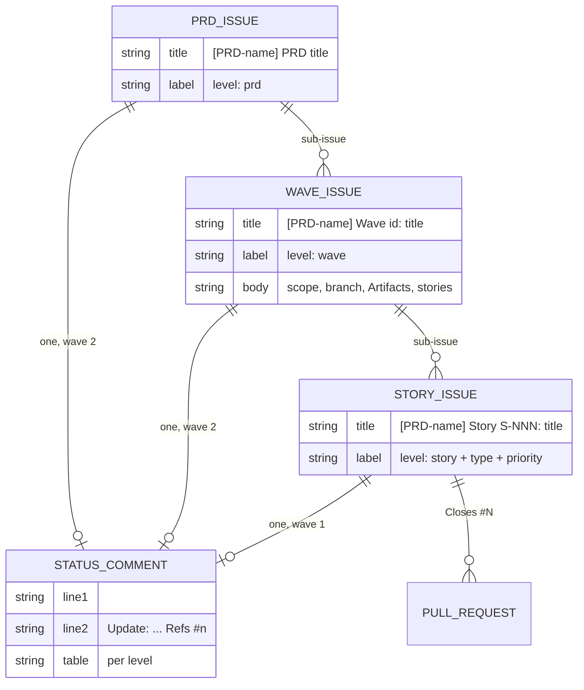
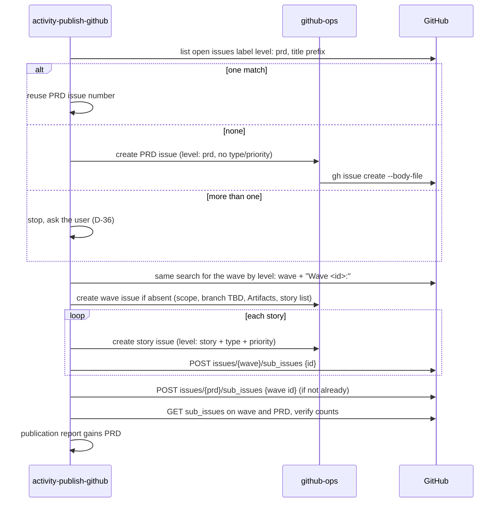
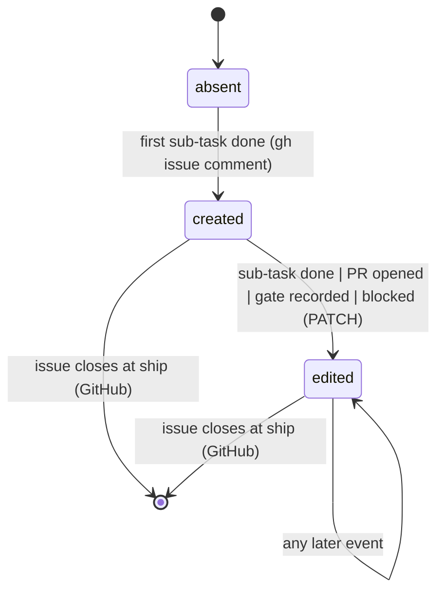

# Specification: projects-tracking — Wave 1, conventions and hierarchy

## Changelog

| Version | Date       | Summary                                                                                                                                                 | Author                    |
| ------- | ---------- | ------------------------------------------------------------------------------------------------------------------------------------------------------- | ------------------------- |
| 1.1 | 2026-10-21 | Write-back after the wave 1 story audits and the Project 5 exercise: §6 search gains the client-side `startswith` filter (S-002 DR-3); §8.3 `wave_status` has four values (S-003 DR-1); §8.4 accepts either template, keeps the seven shipped workflows including Auto-close enabled, makes field cleanup optional (D-45 to D-48); HOW decisions D-40 to D-49 listed. | product-engineer |
| 1.0     | 2026-10-20 | Initial specification for wave 1 (FR-1 to FR-10, FR-23, FR-24) after the HOW-phase interview (D-28 to D-39, 3 asked, 9 self-resolved). | @llipe / product-engineer |

## 1. Executive Summary

Wave 1 is prompt text and tests. It changes five prompt files in each of the three trees so that publish creates a PRD and wave tracking issue and attaches stories as sub-issues, github-ops carries the title forms, the `level:` labels, the retired stage labels and the one status-comment template, implement makes the story status comment mandatory and marker-identified, activity-init gains a Project setup step with a runbook, and one parity test file pins all of it. No `core/` code changes (D-24).

## 2. Reference Documents

- PRD: `docs/requirements/prd-projects-tracking.md` v1.3, wave 1 is FR-1 to FR-10, FR-23, FR-24.
- Decisions: `workstream/decisions-projects-tracking.md` D-01 to D-39.
- Research: `workstream/research-projects-tracking-phase-1.md` (file map, line ranges per tree, parity-test pattern, runbook contract).
- Technical guidelines: `docs/tech.md` §§ Overview, Three-tree parity, Grilling; `SIMPLICITY.md` A2, D.
- Experiment evidence: `llipe/riel` `workstream/experiment-projects-campaign-ui.md` (2026-10-20).

## 3. Affected Repositories

| Repository        | Role              | Scope of Changes                                                                                                                                                                                      |
| ----------------- | ----------------- | ----------------------------------------------------------------------------------------------------------------------------------------------------------------------------------------------------- |
| `llipe/dev-tasks` | Sole repository   | github-ops, activity-publish-github, activity-init, developer, implement in three trees; one runbook; `docs/runbooks/README.md` row; one parity test file; `TESTING.md` dogfood rows; `docs/roadmap.md` row |

## 4. System Architecture

Wave 1 touches the prompt trees only. The diagram shows which prompt file owns which convention and which agent reads it at which event.

Per-tree paths (research artifact, file map):

| Concern                   | `.claude/`                                      | `.github/`                                              | `.kiro/`                                     |
| ------------------------- | ----------------------------------------------- | ------------------------------------------------------- | -------------------------------------------- |
| github-ops                | `agents/github-ops.md`                          | `agents/github-ops.agent.md`                            | `agents/github-ops.md`                       |
| activity-publish-github   | `skills/activity-publish-github/SKILL.md`       | `skills/activity-publish-github/SKILL.md`               | `skills/activity-publish-github/SKILL.md`    |
| activity-init             | `skills/activity-init/SKILL.md`                 | `skills/activity-init/SKILL.md`                         | `skills/activity-init/SKILL.md`              |
| developer                 | `agents/developer.md`, `commands/developer.md`  | `agents/developer.agent.md`                             | `agents/developer.md`                        |
| implement                 | `skills/implement/SKILL.md`                     | `instructions/implement.instructions.md`                | `steering/implement.md`                      |

## 5. Data Model & Database Design

No database. The entities are GitHub objects and one comment convention. The diagram shows the hierarchy and where the status comment attaches.

Naming: titles per FR-1 and D-04; `<id>` from the roadmap's Phase/Wave cell (D-32). Labels: `level: prd`, `level: wave`, `level: story` in one indigo family; `status: blocked`, `status: needs-refinement`, `status: deferred` remain; `status: ready` and `status: in-progress` leave the taxonomy table (D-31). Migration of existing issues is wave 3.

## 6. API Design

No service API. The `gh` surface each change uses, all REST, `repo` scope only:

| Operation                        | Command                                                                                                         | Used by                 |
| -------------------------------- | --------------------------------------------------------------------------------------------------------------- | ----------------------- |
| Find tracking issue (D-36)       | `gh issue list --label "level: prd" --search "[PRD-<name>] in:title" --state open --json number,title --jq 'map(select(.title \| startswith("[PRD-<name>]")))'` | publish                 |
| Create tracking issue            | `gh issue create --title ... --label "level: prd" --body-file ...` (same for `level: wave`)                     | publish via github-ops  |
| Child numeric id                 | `gh api repos/{o}/{r}/issues/{n} --jq .id`                                                                      | publish                 |
| Attach sub-issue                 | `gh api -X POST repos/{o}/{r}/issues/{parent}/sub_issues -F sub_issue_id=<id>`                                  | publish                 |
| Verify hierarchy                 | `gh api repos/{o}/{r}/issues/{parent}/sub_issues --jq '.[].number'`                                             | publish, tests (dogfood)|
| Parent lookup (FR-24)            | `gh api repos/{o}/{r}/issues/{n}/parent` (404 → `skipped(no parent)`, D-29)                                     | developer, main thread  |
| Find status comment (D-26, D-37) | `gh api repos/{o}/{r}/issues/{n}/comments --paginate --jq '.[] \| select(.body \| startswith("<!-- dev-tasks:status -->")) \| .id'` | implement |
| Create status comment            | `gh issue comment {n} --body-file <file>`                                                                       | implement               |
| Edit status comment              | `gh api -X PATCH repos/{o}/{r}/issues/comments/{id} -F body=@<file>`                                            | implement               |

Inline `--body` is blocked by git-guard for `gh`; every body goes through `--body-file` or `-F body=@file`.

The publish sequence, including the reuse path:

## 7. Authentication & Authorization Design

The caller's existing `gh` login with `repo` scope. No `project` scope is needed by any agent (D-23, D-24); the runbook's human needs it once. Merge authority is unchanged.

## 8. Business Logic Implementation

### 8.1 github-ops (FR-1, FR-2, FR-7, D-33)

- Title Format table gains two rows: `PRD tracking issue` → `[PRD-<name>] <PRD title>`; `Wave tracking issue` → `[PRD-<name>] Wave <id>: <title>`, with a sentence on `<id>` (D-32).
- Standardized Main Issue Tags gains a **Level** category with the three labels and colors; the Status rows `status: ready` and `status: in-progress` are removed; `status: deferred` is added as a flag with the description "Parked by decision; not closed". The rule "Every issue MUST have at least one `type:` label and one `priority:` label" gains "except issues labeled `level: prd` or `level: wave`" (D-05).
- Issue Comments rules gain a **Status comment** subsection (D-33, D-37): the marker as line one; the `🔄 Update:` line with `Refs #<issue>` as line two; the three tables below; "exactly one per issue, found by the marker, edited in place with `gh api -X PATCH`; every other comment is append-only".

Story table (wave 1): `Sub-tasks | Current | Branch | PR | Gates | Blocker | Updated`. Wave and PRD tables are defined here too so the planner in wave 2 has nothing to invent: wave `Story | State | PR | Sub-task`, plus lines for current story, last merged PR, integration HEAD, gates; PRD `Wave | State | Wave issue`.

- The `.github/` and `.kiro/` github-ops copies currently say "GitHub MCP SHOULD be used when available" (research artifact, wording differences); wave 1 aligns the sentence with `.claude/`'s "`gh` CLI is the primary execution path" in the same edit as FR-9, so the parity test can assert one sentence in three places.

### 8.2 activity-publish-github (FR-3, FR-4, FR-9, D-36)

- Execution method rules: `gh` primary, MCP optional, method still recorded.
- Clarifying Questions: the "parent epic or project board association" question is removed; the hierarchy is not optional.
- Process gains, before story creation: find-or-create the PRD tracking issue, then the wave tracking issue, by the D-36 search; more than one match stops with the numbers listed.
- Wave issue body template: scope line from the PRD's delivery table, `Integration branch: TBD` (the planner fills it in wave 2), `## Artifacts` with the spec and story-set paths as root-relative links and `Task plan: pending`, `## Stories` list. No checkboxes (D-14).
- After each story is created: attach it as a sub-issue; after all: attach the wave under the PRD if not already; verify with the sub_issues read and report `hierarchy: verified(<n> of <n>)` or `failed(<reason>)`.
- Publication report gains `PRD issue`, `Wave issue` and `Hierarchy` lines under the header.

### 8.3 implement and developer (FR-23, FR-24, D-28, D-29, D-30, D-38)

- implement's optional "SHOULD add brief issue or PR comments" (SKILL.md:124) becomes: "MUST keep the story's status comment current per github-ops § Status comment: create it at the first sub-task completion, edit it in place at every later sub-task completion, at PR open, at each gate recorded, and on block." The checklist alignment rules (104-118) are unchanged.
- Procedure in implement: find by marker; absent → `gh issue comment --body-file`; present → PATCH. Each write reported as `status_comment: written | failed(<reason>) | skipped(no issue)`.
- Main-thread rule (FR-24): after PR open and at PR ready, `GET issues/{n}/parent`; 200 → edit the wave's status comment's row for this story, creating the comment from the wave table if absent, and report `wave_status: written`, or `failed(<reason>)` when the edit is refused; 404 → `wave_status: skipped(no parent)`. Under the planner the developer reports `wave_status: owned-by-planner`. Four values in all (S-003 DR-1).
- developer agent (three trees) and `/developer` command: the completion report gains `status_comment:` and `wave_status:` beside `checklist_sync:` (`.claude/agents/developer.md:376`); rule 6 "do not close issue early" is reworded to define merged as merged to main (FR-13 is wave 2, the wording change is harmless now and avoids a second edit).
- The lifecycle table row "Before coding" is unchanged; a "During" row gains "update status comment".

### 8.4 activity-init (FR-8, D-10, D-35)

- A sibling subsection after "Repository Setup — Branch Protection (Required)": "Repository Setup — GitHub Project (Recommended)", four sentences and a pointer to `docs/runbooks/runbook-configure-github-project.md`.
- The runbook, from `templates/runbooks/runbook-template.md`: frontmatter `name`, `trigger`, `owner: product-engineer`, `last_verified: 2026-10-21`, `related: [docs/requirements/prd-projects-tracking.md]`; steps: `gh auth refresh -s project`, create the Project from the Board or the Team planning template, keep its Status options and the seven shipped workflows as they are (Auto-close issue included, it ships enabled; there is no "item reopened" default), set auto-add to `is:issue`, optionally delete the Team planning extras Priority, Size, Estimate, Start date, Target date, create the three views with their filter strings, verify with `gh project view` and `gh project field-list`. Row added to `docs/runbooks/README.md`.

### 8.5 Parity test (FR-10, D-34)

`test/unit/projects-tracking-parity.test.ts`, one `describe` per changed file, each `it` reading the three tree copies with `stripFrontmatter()` and asserting a marker sentence with `toContain()`; section-scoped with `splitIntoSections()` for the two negative assertions (no `status: ready` row in the taxonomy table; no `gh project item-edit` anywhere in any tree, AC-3). Markers: the two title rows, `level: prd`, the exemption sentence, `<!-- dev-tasks:status -->`, "MUST keep the story's status comment current", "`gh` CLI is the primary execution path", the runbook path in activity-init.

State transitions of the story status comment:

## 9. Integration Details

GitHub REST through `gh`. Failure handling: a failed write is reported in the field, never retried silently, never blocks the sub-task (same policy as memo writes in CLAUDE.md). A blocked `gh` call by git-guard is surfaced verbatim and stops that line of work, per CLAUDE.md.

## 10. User Interface & Client Behavior

None. The visible surfaces are the issues, the comment and the Project views the runbook names.

## 11. Performance & Scalability Approach

One comment list read plus one PATCH per event; for a seven-sub-task story about ten calls. Comment pagination uses `--paginate`; the marker comment is found on the first page in practice since it is created first.

## 12. Security Implementation

No new credential. Comment bodies go through files, never inline, so an issue title cannot inject into a shell command. The Project is never written by an agent (D-23).

## 13. Error Handling & Logging

Every write has a reported outcome field (`hierarchy`, `status_comment`, `wave_status`) with `written | verified | failed(<reason>) | skipped(<reason>)`. More-than-one-match in publish stops with the numbers listed (D-36).

## 14. Testing Strategy

- Layer 1: the parity test file (8.5) plus the existing suite. `pnpm run validate` green (AC-11, now AC-14).
- Dogfood (D-39): AC-1 is first exercised by wave 2's publish; AC-3 by wave 1's own `/developer` runs, where the story status comment on each wave 1 issue is the evidence. `TESTING.md` gains a "Dogfood checks" row per criterion with the satisfying issue number once observed; the verifier rollup records them.
- The runbook is exercised once on this repository's Project before the wave closes.

## 15. Deployment & Rollout

Prompt text ships with the package. Consumers on the next `dev-tasks update` receive the conventions; their existing issues are untouched until wave 3. Rollback is a revert of the prompt files; no data changes.

## 16. Dependencies & Risks

- GitHub sub-issues REST remains available on user-owned repositories (PRD assumption).
- Three-tree wording differences (research risk 1): handled by aligning the MCP sentence in the same change.
- Mid-execution task lists (research risk 3): none active in this repository; a consumer's in-flight story simply gains the comment at its next sub-task.
- Hand-written runbook frontmatter parser (research risk 4): the runbook uses the inline bracket form for `related`.

## 17. Open Questions

None.

## Decisions (HOW phase)

| ID   | Decision (short form)                                                       |
| ---- | --------------------------------------------------------------------------- |
| D-28 | No issue → `status_comment: skipped(no issue)`.                             |
| D-29 | No parent → `wave_status: skipped(no parent)`.                              |
| D-30 | Two new fields in the developer completion report.                          |
| D-31 | Wave 1 retires the two stage labels from the taxonomy only.                 |
| D-32 | Wave `<id>` comes from the roadmap's Phase/Wave cell.                       |
| D-33 | github-ops owns the one status-comment template.                            |
| D-34 | One parity test file, existing helpers.                                     |
| D-35 | Runbook per template, docs-structure check.                                 |
| D-36 | Publish finds tracking issues by `level:` label plus title prefix.          |
| D-37 | Marker is the first line, an invisible HTML comment.                        |
| D-38 | The rule lives in implement; agent and command inherit.                     |
| D-39 | Static parity tests plus next-wave dogfood verify behaviour.                |
| D-40 | activity-init subsection stays `##`; heading pin bumped to 17.              |
| D-41 | S-001 aligns every MCP-primary passage in github-ops.                       |
| D-42 | S-001 and S-002 dogfood rows read `n/a (pre-rule)`.                         |
| D-43 | "Pull request linked to issue" is a default automation.                     |
| D-44 | The no-Project-writes guard walks `docs/` too (requirements excluded, D-49). |
| D-45 | Auto-close issue ships enabled; left as shipped; fires only on human edits. |
| D-46 | Board or Team planning template; both Status sets accepted.                 |
| D-47 | No "item reopened" default workflow.                                        |
| D-48 | Template fields kept by the owner; cleanup optional.                        |
| D-49 | Guard walk excludes `docs/requirements/`, which quotes the forbidden verbs. |

WHAT-phase decisions consumed: D-02 to D-05, D-07, D-10, D-14, D-22 to D-26.

## Vocabulary

| Term           | Status in glossary | Bounded context                  | Definition (proposals only) | Forbidden synonyms (proposals only) |
| -------------- | ------------------ | -------------------------------- | --------------------------- | ----------------------------------- |
| tracking issue | existing           | AI-assisted development workflow |                             |                                     |
| status comment | existing           | AI-assisted development workflow |                             |                                     |
| runbook        | existing           | AI-assisted development workflow |                             |                                     |
| decision log   | existing           | AI-assisted development workflow |                             |                                     |
