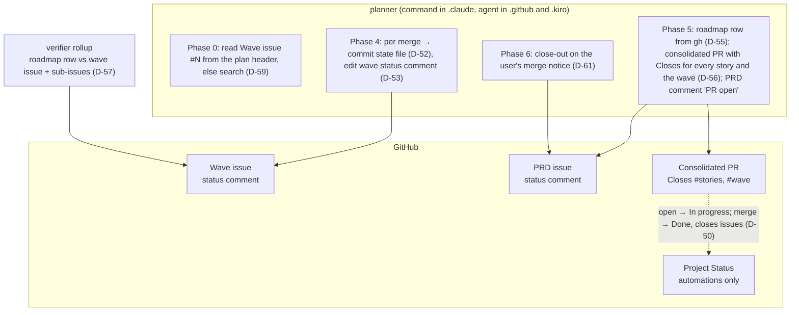
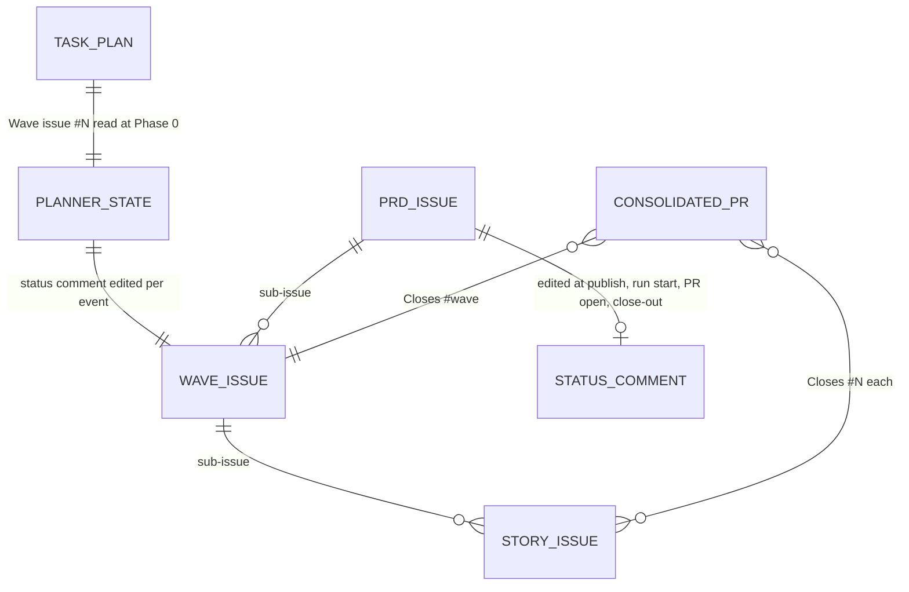
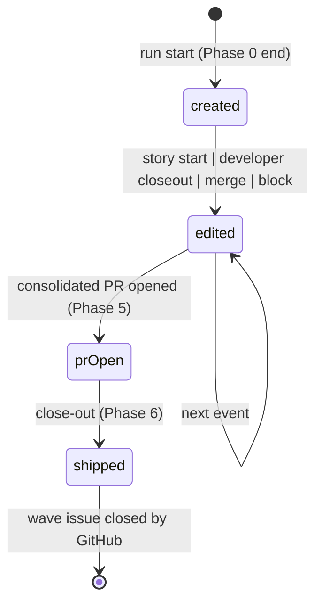

# Specification: projects-tracking — Wave 2, planner and verifier

## Changelog

| Version | Date       | Summary                                                                                                                               | Author                    |
| ------- | ---------- | ------------------------------------------------------------------------------------------------------------------------------------- | ------------------------- |
| 1.0     | 2026-10-21 | Initial specification for wave 2 (FR-11 to FR-16, FR-25; #285) after the HOW-phase interview (D-52 to D-61, 2 asked, 8 self-resolved). | @llipe / product-engineer |

## 1. Executive Summary

Wave 2 makes the planner and the verifier native to the hierarchy wave 1 shipped. The planner commits its checkpoint on the integration branch, keeps one status comment on the wave issue and one on the PRD issue, never closes a story, writes `Closes` for every story and the wave into the consolidated PR so GitHub moves Status and closes issues at ship (D-50), derives the roadmap row from `gh` output, and gains a close-out phase that runs when the user reports the merge. The verifier's rollup compares the roadmap row with the wave issue and its sub-issues. Everything is prompt text in three trees plus tests; no `core/` change.

## 2. Reference Documents

- PRD `docs/requirements/prd-projects-tracking.md` v1.6: FR-11 to FR-16, FR-25; AC-8, AC-9, AC-10, AC-15.
- Decisions `workstream/decisions-projects-tracking.md`: D-11, D-12, D-13, D-22, D-25, D-26, D-36, D-50, D-52 to D-61.
- Follow-up issue #285 (D-50 inheritance), rollup `workstream/fidelity-report-projects-tracking-phase-1-rollup.md` R-1, R-3, R-6.
- Research `workstream/research-projects-tracking-phase-2.md` (line ranges per tree; planner gate divergence; parity helpers).
- Wave 1 specification v1.1 §8 (the status-comment procedure and templates this wave reuses).

## 3. Affected Repositories

| Repository        | Role            | Scope of Changes                                                                                                                                                                                                                 |
| ----------------- | --------------- | -------------------------------------------------------------------------------------------------------------------------------------------------------------------------------------------------------------------------------- |
| `llipe/dev-tasks` | Sole repository | planner (command plus two agents), verifier ×3, github-ops ×3 (`## Why` rule), implement ×3 (close rules), activity-publish-github ×3 (PRD comment at publish), plan ×3 (`Wave issue:` header line), `TESTING.md` DF-5, parity test blocks |

## 4. System Architecture

The planner is the only new writer of GitHub state in this wave, and every write is a comment edit, a PR body, or a commit; Project Status still moves only through GitHub's automations.



Per-tree paths: planner `.claude/commands/planner.md`, `.github/agents/planner.agent.md`, `.kiro/agents/planner.md`; verifier `.claude/agents/verifier.md`, `.github/agents/verifier.agent.md`, `.kiro/agents/verifier.md`; implement `.claude/skills/implement/SKILL.md`, `.github/instructions/implement.instructions.md`, `.kiro/steering/implement.md`; plan `.claude/skills/plan/SKILL.md`, `.github/instructions/plan.instructions.md`, `.kiro/steering/plan.md`; github-ops and activity-publish-github as in wave 1.

## 5. Data Model & Database Design

No database. Two text records change shape:

- **Planner state file** (`workstream/planner-state-<plan-id>.md`): Run Info gains `Wave issue: #N | none` after `Repository`; the Story Status table is unchanged; the file is committed on the integration branch after every merge (D-52) and archived to `workstream/archive/planner-state-<plan-id>-archived.md` at close-out (D-58).
- **Task plan header** (`workstream/tasks-<prd>-phase-<N>-plan.md`): gains `Wave issue: #N` on its own line after `Source:`, written by `plan` from the publication report's `Wave issue` line (D-59).



## 6. API Design

All `gh`, REST, `repo` scope. New or changed uses:

| Operation                               | Command                                                                                                                        | Used by          |
| --------------------------------------- | ------------------------------------------------------------------------------------------------------------------------------ | ---------------- |
| Wave issue fallback search (D-59, D-36) | `gh issue list --label "level: wave" --search "[PRD-<name>] Wave <id>: in:title" --state open --json number,title --jq 'map(select(.title \| startswith("[PRD-<name>] Wave <id>:")))'` | planner Phase 0 |
| Wave and PRD status comment            | implement § Status Comment procedure: find by marker, create with `gh issue comment --body-file`, edit with `gh api -X PATCH … -F body=@file` | planner |
| Story states for the roadmap (D-55)     | `gh issue list --search "[PRD-<name>] in:title" --state all --json number,state`                                              | planner Phase 5  |
| Story PRs for the roadmap (D-55)        | `gh pr list --base <integration branch> --state merged --json number`                                                          | planner Phase 5  |
| Merge verification at close-out (D-61)  | `gh pr view <n> --json state,mergedAt,mergeCommit`                                                                             | planner Phase 6  |
| Project confirmation at close-out       | `gh project item-list <project> --owner <owner> --format json` read only, when `docs/roadmap.md` or the runbook names a Project; otherwise skipped | planner Phase 6 |
| Sub-issue states for the rollup (D-57)  | `gh api repos/{o}/{r}/issues/{wave}/sub_issues --jq '.[] \| {number,state}'`                                                  | verifier rollup  |

Consolidated PR open and close-out, with the D-50 transitions:

```mermaid
sequenceDiagram
  participant PL as planner
  participant GH as GitHub
  participant PJ as Project automations
  participant U as user
  PL->>GH: open consolidated PR, body: Closes #s1 … #sn, Closes #wave (D-56)
  GH->>PJ: PRs against main link the issues
  PJ->>PJ: Status → In progress for every story and the wave
  PL->>GH: PRD status comment: wave "consolidated PR #n open"
  PL->>GH: TESTING.md DF-5 observation recorded in the PR (#285)
  U->>GH: review, approve, merge
  GH->>GH: issues close (closing keywords, default branch)
  GH->>PJ: Status → Done
  U->>PL: "PR merged"
  PL->>GH: gh pr view: MERGED (D-61)
  PL->>PL: roadmap row Done from gh; state file archived; chore PR
  PL->>GH: PRD status comment: wave shipped
```

## 7. Authentication & Authorization Design

Unchanged: the caller's `gh` login with `repo` scope. The close-out Project read needs no extra scope beyond what the person who ran the runbook already has; it is skipped with a reason when the read is refused. Merge authority unchanged: the planner never merges to main.

## 8. Business Logic Implementation

### 8.1 plan skill, three trees (D-59)

The Output Format's header gains `Wave issue: #N` after `Source:`. The Process reads the number from the publication report's `Wave issue` line; when the report predates wave 1 or has none, the line reads `Wave issue: none` and a note says the planner will search.

### 8.2 planner, three copies (FR-11 to FR-15, D-52 to D-56, D-58 to D-61)

- **Phase 0, Discover Task Source:** after the roadmap read, resolve the wave issue: the plan header line; else the D-36 search; else `wave_status: skipped(no wave issue)`, recorded in the state file's Run Info. Record `Wave issue: #N | none` there.
- **Phase 0.5, State File Format:** Run Info gains the `Wave issue` line. Resume reads it.
- **Phase 4, handoff template:** gains `Wave issue: #N | none` so the developer's `wave_status` reads `owned-by-planner` (implement § Wave Status Update).
- **Phase 4, merge rule step 13:** after verifying the merge, (a) update the state file and `git add -f` it, then commit on the integration branch with `chore(planner): checkpoint after <story> merge` and push (D-52); (b) edit the wave issue's status comment in place per implement § Status Comment and github-ops's wave table: every story's state, current story, last merged PR, integration HEAD, gates (D-53). The sentence "post a GitHub Issue comment on the plan/milestone issue" is removed. The wave comment is also edited at run start (created if absent), at each story start, at each developer closeout, and on block (FR-12).
- **Phase 4, closing:** a new sentence under the merge rule: the planner never closes a story issue; the story closes when the consolidated PR merges to main (D-54, FR-13).
- **Phase 5, step 5 roadmap:** the row's `Status` is `In progress`, `Issues/PRs` is built from the two `gh` commands of D-55, `What's missing` names the consolidated PR; the commands are cited in the PR body's Roadmap section.
- **Phase 5, step 7 consolidated PR:** the body's `## What` carries `Closes #N` for every story in the state table and `Closes #<wave>` when a wave issue exists (D-56); the "Consolidated PR should include" list gains the `Closes` lines, the roadmap commands, and the DF-5 observation: after opening, the planner reads the Project Status of one story when a Project is configured and records "In progress at consolidated PR open: observed | not observed(<reason>)" in the PR body and `TESTING.md` (#285). The PRD status comment is edited: the wave's row reads "consolidated PR #n open" (FR-25).
- **Phase 5, step 9:** "Wait for the user to approve and merge" is followed by "then run Phase 6".
- **Phase 6, Close-out (new, D-61):** triggered by the user reporting the merge. Steps: `gh pr view` must show `MERGED`; pull main; delete the integration branch locally and remotely; confirm every story issue and the wave issue are closed; when a Project is configured, read the items and confirm Done; set the roadmap row to `Done` with `Issues/PRs` naming the stories, story PRs and consolidated PR and `What's missing` `—`; archive the state file (D-58); record the DF-5 Done observation in `TESTING.md`; edit the PRD status comment so the wave reads "shipped"; open one `chore(roadmap)` PR to main for the user. The Output Contract and Invariants name Phase 6 as the end of the run.
- Wording that differs between the three copies today (merge gates 5, 6, 13) stays as it is; wave 2 adds identical sentences in all three (D-60).

### 8.3 activity-publish-github, three copies (FR-25)

After the hierarchy is verified, the PRD tracking issue's status comment is created or edited per github-ops's PRD table: one row per wave with its state (`published`) and a link to its wave issue. This is product-engineer's write at publish time.

### 8.4 verifier, three copies (FR-16, D-57)

The Roadmap-Mismatch Finding's triggers compare the row with the wave tracking issue and its sub-issues when the wave has one (found by the D-36 search): trigger 1 uses the sub-issues' states and the wave issue's state instead of "the delivered tree" alone; trigger 4 compares `Issues/PRs` with the sub-issue numbers. Without a wave issue the current comparison against merged PRs stands. The finding remains advisory.

### 8.5 github-ops, three copies (D-56)

The `## Why` rule gains: "A consolidated PR from an integration branch to the default branch MUST carry `Closes #<number>` for every story issue it delivers and for the wave tracking issue; `Refs` is for everything else."

### 8.6 implement, three copies (D-54)

Rules 12 and 13 and the lifecycle row "Then close issue" are rewritten: nobody closes the issue; it closes when a PR against the default branch carrying `Closes #N` merges, which under the planner is the consolidated PR. Final Instruction 5 matches.

### 8.7 Parity tests (D-34)

`test/unit/projects-tracking-parity.test.ts` gains `describe("planner")`, `describe("verifier")`, `describe("plan")`, and extends the github-ops, implement and publish blocks. `loadTrees` takes explicit paths for the planner (one command, two agents) and the plan files. Markers: `Wave issue:` in the state format and the plan header; `git add -f` and the checkpoint commit message; "never closes a story issue"; `Closes #<wave>`; the two roadmap commands; `## Phase 6`; the PRD table reference in publish; the sub-issue comparison in the verifier; the `## Why` consolidated-PR sentence; the absence of "post a GitHub Issue comment on the plan/milestone issue" and of "Then close issue".

State of the wave status comment across a run:



## 9. Integration Details

`gh` only. Failed comment edits are reported in the state file's Decisions Log and the run summary, never retried silently. A git-guard block stops the line of work and is reported verbatim.

## 10. User Interface & Client Behavior

None.

## 11. Performance & Scalability Approach

Per merge: one commit, one push, one comment list read, one PATCH. Per run: two list reads for the roadmap row, one Project read at PR open and one at close-out.

## 12. Security Implementation

No new credential. Comment bodies and PR bodies go through files. The close-out's Project access is a read.

## 13. Error Handling & Logging

`wave_status: skipped(no wave issue)` when discovery fails; `prd_status: written | failed(<reason>) | skipped(no PRD issue)` for the PRD comment; `project_observation: observed | not observed(<reason>)` for DF-5. Close-out refuses to proceed when `gh pr view` does not report `MERGED`.

## 14. Testing Strategy

- Layer 1: the parity blocks of §8.7; `pnpm run validate`.
- Dogfood (D-39): wave 2's own `/planner` run is the first with a wave issue, so DF-3 (200 path) is still a main-thread event, but the wave status comment, the PRD comment, the `Closes` lines, the DF-5 In progress observation and the close-out are all observed on this wave's run and recorded in `TESTING.md` by the planner at close-out.
- Publish of this wave is the first real run of wave 1's hierarchy (DF-1); the publication report records it.

## 15. Deployment & Rollout

Prompt text ships with the package; consumers receive it on update. Rollback is a revert. Repositories without a wave issue degrade to wave 1 behaviour with `skipped(no wave issue)`.

## 16. Dependencies & Risks

- The planner's three copies already diverge on merge gates (D-60); the parity blocks pin only added sentences.
- A Project read at close-out is optional and skipped when no Project is configured; the DF-5 observation then reads `not observed(no project)`.
- `plan` and `implement` are instruction and steering files on Copilot and Kiro; the test file reads them by explicit path.

## 17. Open Questions

None.

## Decisions (HOW phase)

| ID   | Decision (short form)                                                       |
| ---- | --------------------------------------------------------------------------- |
| D-52 | Force-add and commit the state file after every merge.                      |
| D-53 | The wave status comment replaces the per-merge comment.                     |
| D-54 | Nobody closes a story; GitHub closes it at ship.                            |
| D-55 | Roadmap row from two `gh` commands, cited in the PR body.                   |
| D-56 | `Closes` for every story and the wave; github-ops rule extended.            |
| D-57 | Rollup compares with the wave issue and sub-issues; merged PRs as fallback. |
| D-58 | State file archived at close-out.                                           |
| D-59 | Wave issue from the plan header, then search, then skip.                    |
| D-60 | Planner tree divergence left as is; only added sentences pinned.            |
| D-61 | Phase 6 Close-out, triggered by the user's merge notice.                    |

WHAT-phase decisions consumed: D-11, D-12, D-13, D-22, D-25, D-26, D-36, D-50.

## Vocabulary

| Term           | Status in glossary | Bounded context                  | Definition (proposals only) | Forbidden synonyms (proposals only) |
| -------------- | ------------------ | -------------------------------- | --------------------------- | ----------------------------------- |
| tracking issue | existing           | AI-assisted development workflow |                             |                                     |
| status comment | existing           | AI-assisted development workflow |                             |                                     |
| roadmap drift  | existing           | AI-assisted development workflow |                             |                                     |
| decision log   | existing           | AI-assisted development workflow |                             |                                     |
