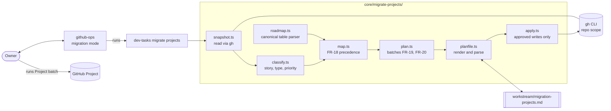
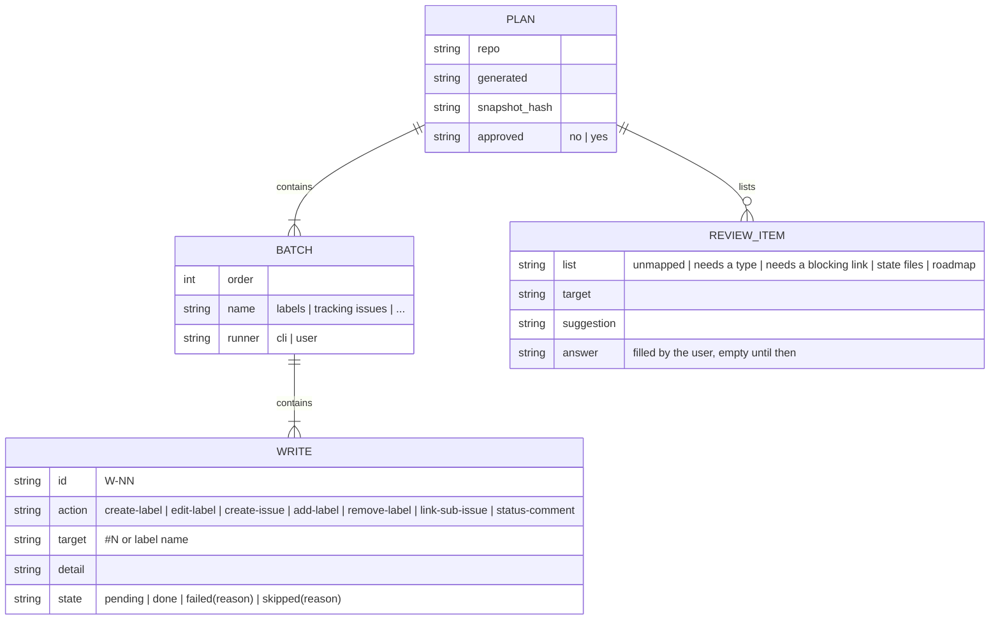
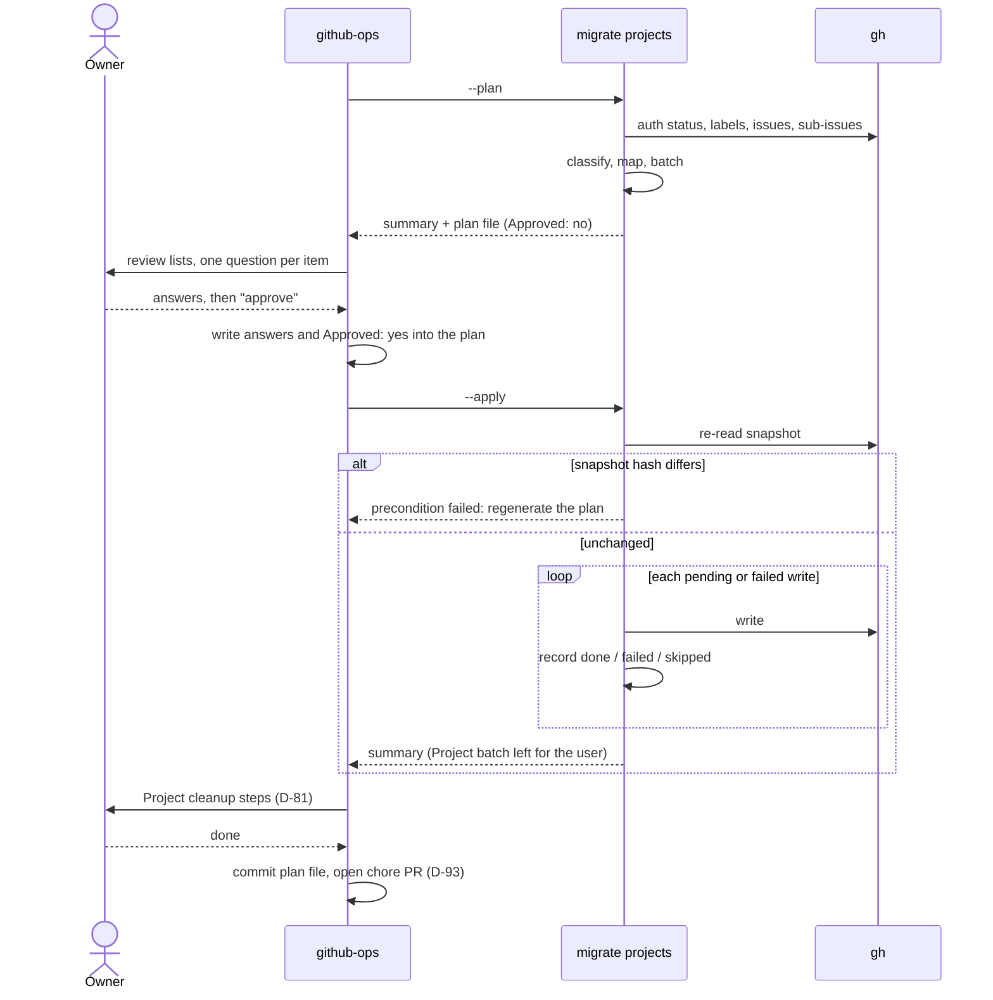
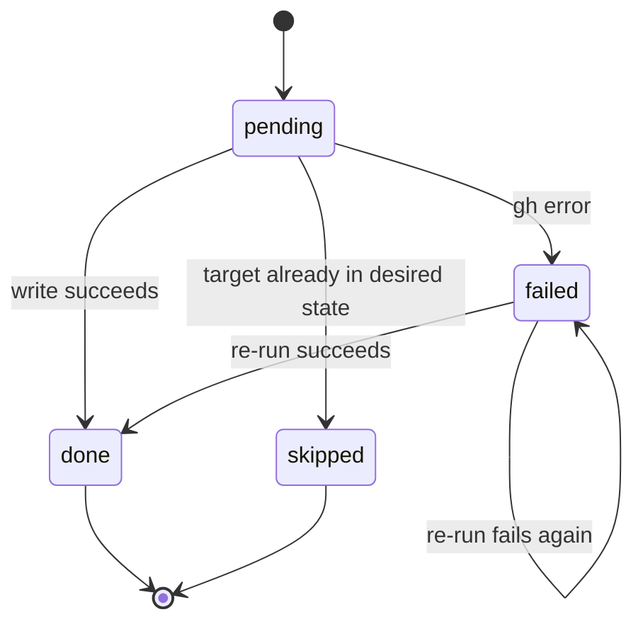

# Specification: projects-tracking — Wave 3, migration of an existing repository

## Changelog

| Version | Date       | Summary                                                                                                                                         | Author                    |
| ------- | ---------- | ----------------------------------------------------------------------------------------------------------------------------------------------- | ------------------------- |
| 1.5 | 2026-10-24 | §16a gains the S-014 audit records (F-2, F-5, F-7, F-8) and D-106 to D-109. | product-engineer |
| 1.4 | 2026-10-24 | §16a A-53: the three accepted PRD-title forms, recorded after the S-013 audit (F-6). | product-engineer |
| 1.3 | 2026-10-24 | Design Mode resolutions A-49 to A-93 confirmed by @llipe: §16a added; D-98 to D-101 (milestone rule dropped, AC-13 amended, default labels, resume check). | product-engineer |
| 1.2 | 2026-10-23 | §8.3 batch 7 prints the Project item query and delete template instead of per-item commands (D-97). | product-engineer |
| 1.1 | 2026-10-23 | §6 exit codes mapped onto the existing `core/exit-codes.ts` values; no new exit code. | product-engineer |
| 1.0     | 2026-10-23 | Initial specification for wave 3 (FR-17 to FR-22, FR-26) after the HOW-phase interview (D-79 to D-96: 9 asked, 9 self-resolved), PRD v1.10. | @llipe / product-engineer |

## 1. Executive Summary

Wave 3 brings an existing repository onto the projects-tracking conventions without guessing. A new CLI command, `dev-tasks migrate projects`, reads the repository through `gh`, writes a reviewable migration plan to `workstream/migration-projects.md`, and applies only an approved plan, recording every write's result so a re-run resumes (D-79, D-88). github-ops' migration mode is the conversation around the command. The wave also sharpens two label axes the migration has to enforce: exactly one `type:` per issue from a defined set, and a priority scale where `priority: critical` means "blocks a ship" and carries a native GitHub issue dependency (D-83 to D-85). dev-tasks migrates itself with the runbook, and the wave is Done when its consolidated PR merges; riel is the owner's test bed afterwards, outside this wave (D-94).

## 2. Reference Documents

- PRD `docs/requirements/prd-projects-tracking.md` v1.10: FR-17 to FR-22, FR-26; AC-11, AC-12, AC-13, AC-16.
- Decisions `workstream/decisions-projects-tracking.md`: D-07, D-15, D-17 to D-21, D-22, D-27, D-36, D-52, D-73, D-76, D-79 to D-96.
- Wave 1 specification (`level:` labels, tracking-issue title forms, sub-issue REST calls, status-comment templates) and wave 2 specification v1.2 (planner resume backfill, S-008 DR-1).
- `docs/tech.md` §§ API and interface design, Dependency management (no silent installation, minimal consumer surprise).
- The 2026-10-23 survey of `llipe/dev-tasks` and `llipe/riel` recorded in D-82, D-85, D-86 and D-95: shapes only, no riel data in tests.

## 3. Affected Repositories

| Repository        | Role            | Scope of Changes                                                                                                                                                                                                                                                                                                                            |
| ----------------- | --------------- | ------------------------------------------------------------------------------------------------------------------------------------------------------------------------------------------------------------------------------------------------------------------------------------------------------------------------------------------- |
| `llipe/dev-tasks` | Sole repository | New `core/migrate-projects/` module and the `migrate projects` subcommand in `bin/dev-tasks.ts`; github-ops ×3 (migration mode, `type:` set, priority scale, `**Blocks:**` line, dependency commands, audit checks); product-engineer ×3 (roadmap conversion step, aggregation by type and priority); activity-publish-github ×3 (one `type:` per story); runbook `docs/runbooks/runbook-migrate-to-projects-tracking.md`; unit tests and fixtures; this repository migrated with the runbook. |

No other repository is touched by this wave (D-94).

## 4. System Architecture

The command is a pipeline from a read-only snapshot to a plan file, and from an approved plan file to recorded writes. The agent never composes the writes itself; it runs the command, walks the user through the lists that need a human answer, and asks for approval.



Boundaries:

- `snapshot.ts` and `apply.ts` are the only files that call `gh`, through one injectable `GhRunner` (D-90). Everything between them is pure and unit-tested.
- Nothing in the module writes the Project (D-81, D-22). The Project batch is printed as commands for the user.
- `docs/roadmap.md` is read, never written, by the command: product-engineer converts it first (D-86).

## 5. Data Model & Database Design

No database. The data model is the in-memory snapshot and the plan file, which is both the approval artifact and the durable record (D-93).



Snapshot (read once per `--plan`): repository labels with descriptions; every open issue with number, title, body, labels, milestone, sub-issues and parent; closed issues are read only for tracking-issue matching; `docs/roadmap.md`'s canonical table; `workstream/planner-state-*.md` files present.

Plan file shape (Markdown, parsed back by `planfile.ts`; one fenced block per batch keeps it both readable and machine-parseable):

```markdown
# Migration plan: <owner/repo>

Generated: 2026-10-23T12:00:00Z
Snapshot: <sha256 of the normalized snapshot>
Approved: no

## Needs your answer

### Unmapped issues (FR-18)
| Issue | Why | Answer (wave id, or "standalone") |

### Needs a type (D-85)
| Issue | Current type labels | Suggested | Answer |

### Needs a blocking link (D-84)
| Issue | Priority | Answer (#issue it blocks, or "lower priority to high") |

## Batches

### 1. Labels (cli)
| ID | Action | Target | Detail | State |
...
### 7. Project cleanup (you run these)
| ID | Step | State |
```

## 6. API Design

The command's interface is its API (tech.md § API and interface design).

```text
dev-tasks migrate projects --plan  [--repo <owner/repo>] [--out <path>]
dev-tasks migrate projects --apply [--plan-file <path>]
```

- `--repo` defaults to the current repository from `gh repo view --json nameWithOwner`; `--out` and `--plan-file` default to `workstream/migration-projects.md`.
- Exit codes reuse `core/exit-codes.ts`, adding none: `Success` (0); `InvalidUsage` (2) for bad flags or a missing canonical roadmap table; `DependencyError` (11) when `gh` is missing or unauthenticated; `ReconciliationConflict` (14) when the plan is not approved or the snapshot changed since it was generated; `GeneralError` (1) when at least one write is `failed`.
- Output: a one-screen summary (counts per batch and per review list) on stdout; the plan file carries the detail. `--json` prints the same summary as JSON for github-ops.

`gh` calls (all REST or `gh` subcommands already used elsewhere in the toolkit):

| Purpose                 | Call                                                                                    |
| ----------------------- | --------------------------------------------------------------------------------------- |
| Auth check (D-96)       | `gh auth status`                                                                        |
| Labels                  | `gh label list --limit 500 --json name,description,color`; `gh label create`/`edit`     |
| Issues                  | `gh issue list --state open --limit 1000 --json number,title,body,labels,milestone`     |
| Sub-issues, parent      | `gh api --paginate repos/{o}/{r}/issues/{n}/sub_issues`; `.../parent`                   |
| Link a sub-issue        | `gh api -X POST repos/{o}/{r}/issues/{parent}/sub_issues -F sub_issue_id=<id>`          |
| Dependencies (D-84)     | `gh api --paginate repos/{o}/{r}/issues/{n}/dependencies/blocked_by` (read only in wave 3) |
| Tracking issue create   | `gh issue create --title ... --label ... --body-file <path>`                            |
| Label add/remove        | `gh issue edit <n> --add-label ... --remove-label ...`                                  |
| Status comment          | wave 1 marker procedure: `gh issue comment --body-file`, `gh api -X PATCH .../comments/{id} -F body=@file` |

Every body goes through a file; inline `--body` is never used (git-guard).

The run, end to end, including the approval gate and a resumed apply:



## 7. Authentication & Authorization Design

`gh` authenticated with the `repo` scope is the only access needed (D-96). `--plan` runs `gh auth status` first and stops with the `gh auth login` hint on failure. The `project` scope is never requested: the Project batch is run by the user with their own session (D-81). Approval is a human act recorded in the plan header; the CLI refuses `--apply` while it reads `Approved: no` (FR-17, D-80).

## 8. Business Logic Implementation

### 8.1 Classification (`classify.ts`)

- **Story** (D-82): an open issue whose title matches `/\bStory S-\d+\b/` or whose body has a `**Story:** workstream/user-stories-...` line. Only stories get `level: story` and a parent.
- **Tracking issue** (D-87): a title starting with `[PRD-<name>]` and nothing else after the bracket than the PRD title, or `[PRD-<name>] Wave <id>:`, matched by the D-36 prefix with or without its `level:` label.
- **Standalone**: everything else, follow-ups included. No `level:`, no parent; its `phase:` label stays (FR-19, D-82).
- **Type check** (D-85): zero or several `type:` labels puts the issue on "needs a type", with a suggestion from the Conventional Commits title prefix (`fix` → `bug`, `feat` → `enhancement`, `test` → `test`, `docs` → `docs`, `refactor` → `refactor`, `chore`/`ci`/`build` → `chore`) and no suggestion otherwise. `type: other` and the experiment's `type: prd|wave|story` count as no type.
- **Priority check** (D-84): `priority: critical` with no `blocked_by` relation pointing at it and no `**Blocks:**` line goes on "needs a blocking link". No link is ever invented.

### 8.2 Mapping (`map.ts`, FR-18)

A story maps to a wave by the first rule that yields exactly one roadmap row:

1. The `**Story:** workstream/user-stories-<slug>-phase-<N>.md` body line → the row of PRD `<slug>`, wave `<N>`.
2. A `phase: X` label → the row whose `Phase/Wave` cell equals `X` exactly (D-86).
3. The milestone, when exactly one roadmap row names it.
4. Otherwise unmapped, with the reason. Unmapped stories wait for the user's answer; the plan never guesses (D-18).

A user answer in the unmapped table is honoured by the next `--plan`, which reads the previous plan file's answers before classifying.

### 8.3 Batches (`plan.ts`, FR-19, FR-20)

| Order | Batch                 | Runner | Contents                                                                                                                                             |
| ----- | --------------------- | ------ | ---------------------------------------------------------------------------------------------------------------------------------------------------- |
| 1     | Labels                | cli    | Create missing `level: prd`, `level: wave`, `level: story`, `type: test`; prefix retired labels' descriptions with `Retired (projects-tracking#D-91):` |
| 2     | Tracking issues       | cli    | One PRD issue per PRD file with at least one mapped story (reuse by D-87, else create); one wave issue per wave with an open story or an active planner state file (FR-19); none for a shipped wave |
| 3     | Hierarchy             | cli    | Link each mapped story under its wave, each wave under its PRD; skip links already present                                                            |
| 4     | Story and type labels | cli    | `level: story` on mapped stories; `level: prd`/`level: wave` on reused tracking issues; confirmed `type:` answers                                     |
| 5     | Retired labels        | cli    | Remove D-91's retired labels from open issues; never delete a definition                                                                              |
| 6     | Status comments       | cli    | Create or edit each PRD issue's status comment by marker, one row per roadmap row, `—` for waves without an issue (D-92, D-73)                        |
| 7     | Project cleanup       | user   | The `gh project item-list` query that lists pull-request items and the `gh project item-delete` template (the CLI never reads the Project, D-97); auto-add filter to `is:issue`; restore default workflows (D-81, FR-20) |

No title is ever changed (D-19). No Status is ever written (D-27).

### 8.4 Write states (`apply.ts`, D-88)



`--apply` re-reads the snapshot and compares its hash first; a difference stops the run with "regenerate the plan" (precondition failed), because a plan approved against a different repository state must not be applied. Each write's state is written back to the plan file after the call, so an interruption loses at most the in-flight write. Batches run in order; a `failed` write does not stop later writes in other batches unless they depend on it (a link whose wave issue failed to create is `skipped(depends on W-NN)`).

### 8.5 Conventions (FR-26, github-ops ×3)

- **Types** (D-85): exactly one `type:` per issue from `enhancement`, `bug`, `security`, `refactor`, `test`, `docs`, `chore`, `tech-debt`, with the definitions and the tie-break order `security > bug > enhancement > refactor > test > docs > chore > tech-debt`. `type: other` is retired. The Labels table gains `type: test`; `tech-debt`'s description narrows.
- **Priorities** (D-84): `critical` blocks a wave, PRD or release from shipping and carries a native `blocked by` relation from the issue it blocks plus a `**Blocks:** #N — <reason>` body line; `high` current wave or cycle; `medium` next; `low` backlog. Any issue that blocks another carries the `**Blocks:**` line whatever its priority.
- **Dependency commands**: `gh api -X POST repos/{o}/{r}/issues/{blocked}/dependencies/blocked_by -F issue_id=<blocker numeric id>` and the matching `DELETE`, documented in github-ops' Command Map. Agents may write issue dependencies: they are issue data, not Project data (D-22 unaffected).
- **Audit**: github-ops' audit mode reports a `critical` issue without a blocking relation, an issue with zero or several `type:` labels, and a retired label on an open issue.
- **Aggregation** (D-83): product-engineer finds post-wave follow-ups by the `Follow-up to #N` body line, bugs to fix by `type: bug` without `level:`, and release blockers by `priority: critical`. No new label category.

### 8.6 Roadmap conversion (product-engineer ×3, FR-21, D-86)

A step in product-engineer's Roadmap Maintenance: when `docs/roadmap.md` has no canonical table, draft one (one row per PRD phase or wave, scope, Status from the fixed set, Issues/PRs from the narrative), keep the existing narrative verbatim below it, flag every Status translated from narrative wording, and ship it as its own docs PR before migration runs. `--plan` refuses to run without the table (D-86).

## 9. Integration Details

`gh` is the only integration; the command never calls the GitHub API directly. GitHub's REST rate limit is ample for a repository of hundreds of issues (one list call plus one sub-issue read per tracking issue); `--paginate` is used on every list. A `gh` error is captured with its exit code and stderr and recorded as `failed(<first stderr line>)`.

## 10. User Interface & Client Behavior

CLI only; no UI and no `/DESIGN.md` impact. The summary is plain text, one line per batch and per review list, ending with the plan file path and the next action (`review the plan`, or `run --apply`, or `run the Project batch`).

## 11. Performance & Scalability Approach

One snapshot read per run; pure stages are linear in the issue count. Writes are sequential, one `gh` call each, so a riel-sized migration (about 100 issues) is a few hundred calls; the per-write state makes a slow run safe to interrupt.

## 12. Security Implementation

No token is read, stored or logged; `gh` holds the credentials. Issue bodies are written to temporary files and passed with `--body-file`. The plan file contains issue titles and label names only, never bodies. Snapshot hashing uses SHA-256 over a normalized, sorted JSON form.

## 13. Error Handling & Logging

| Condition                         | Behavior                                                                  |
| --------------------------------- | ------------------------------------------------------------------------- |
| `gh` missing or unauthenticated   | precondition failed, `gh auth login` hint, nothing read                    |
| No canonical roadmap table        | precondition failed, pointer to product-engineer's roadmap conversion      |
| Two tracking-issue matches        | that PRD's batches are omitted; both issues listed for the user (D-87)    |
| `--apply` with `Approved: no`     | precondition failed, nothing written                                       |
| Snapshot changed since the plan   | precondition failed, "regenerate the plan", nothing written                |
| A write fails                     | `failed(<reason>)` recorded, run continues, exit code partial failure      |

## 14. Testing Strategy

- **Unit, pure stages:** `classify`, `map`, `plan` and `planfile` (render then parse round-trips) with synthetic fixtures shaped like the survey (D-95).
- **AC-11 fixture:** one PRD, two waves, six stories (two by body line, two by `phase:` label, one by milestone, one unmappable), one standalone bug, plus a `type: prd` tracking issue, retired labels, and issues with zero and two `type:` labels. Assert the batches FR-19 permits, the unmapped and needs lists, no title change, no parent for the bug, and zero write calls from `--plan` (D-90).
- **AC-12:** `--apply` against a recording `GhRunner`: retired labels removed from open issues only, no definition deleted, no Project call, no Status write; an interrupted run resumed from the plan file repeats no `done` write.
- **AC-13:** the fixture roadmap passes `roadmap-parity`'s canonical-table check; a state file without the `Wave issue` line is listed, not edited (D-89).
- **AC-16 (FR-26):** parity pins across the three trees for the type set and tie-break, the priority scale, the `**Blocks:**` line and the dependency command; the audit's three new checks pinned.
- **Guards:** PT-80 extends the Project-write guard to `core/migrate-projects/` (§16a, A-60); no Project write may appear there.
- **Dogfood:** this repository migrated with the runbook; the committed plan file is the evidence (D-93).

## 15. Deployment & Rollout

Ships in the next dev-tasks release with the runbook in the same PR (FR-22, FR-49a). Order: product-engineer roadmap check (this repository's roadmap is already canonical), `--plan`, review, `--apply`, the Project batch, the chore PR with the plan file. Rollback: every CLI write is reversible by hand from the plan file's table (labels re-added, sub-issue links removed, created tracking issues closed); nothing is deleted. Wave 3 is Done when the consolidated PR merges; riel follows as the owner's test bed, outside this wave (D-94).

## 16. Dependencies & Risks

| Risk                                                                   | Mitigation                                                                                        |
| ---------------------------------------------------------------------- | ------------------------------------------------------------------------------------------------- |
| GitHub's issue-dependencies API changes (newer than sub-issues)         | Wave 3 only reads dependencies in the CLI; writes are documented commands, easy to update          |
| The plan file grows large and hard to review                            | Review lists first; batches summarized with counts; per-write rows below                          |
| A story title pattern other than `Story S-NNN` in some repository       | It lands on the unmapped list, never mis-mapped; the pattern lives in one constant                  |
| Approving a stale plan                                                  | Snapshot hash check before any write                                                              |

## 16a. Design Mode resolutions (v1.3)

The Design Mode findings A-49 to A-93 (`workstream/test-plan-projects-tracking-phase-3.md`) were resolved by the user on 2026-10-24. Where this section and an earlier one differ, this section wins.

**Plan-file integrity**

- **A-49 (D-101).** `--apply` compares the snapshot hash only while every row reads `pending`. Once any row is `done` or `skipped`, each write checks its own target's live state just before it runs: `skipped(already applied)` when the target is already in the desired state, `failed(target changed)` when it is in neither the before nor the after state.
- **A-50.** `--apply` never derives writes from answers. After the owner answers the review lists, github-ops re-runs `--plan`, which reads the answers, rebuilds the batches and resets `Approved: no`; the owner approves the final batches. The §6 sequence diagram, S-015's "unanswered review row" edge case and S-017 AC-2 follow this.
- **A-51.** The header gains `Plan digest:`, a SHA-256 over the batch rows' ID, Action, Target and Detail columns. `--apply` recomputes it and exits 14 when it differs. Action is a closed set; argv is built from Action, Target and Detail only, never from free text.
- **A-65.** `--plan` refuses, with exit 14, to overwrite a plan file that has any row other than `pending`. Task 6.6's verification re-runs `--plan --out <scratch path>`.
- **A-77, A-78, A-79.** The plan file has one review table per list: unmapped, needs a type, needs a blocking link, state files, roadmap notes, and an "Information" table for the remaining notes. The header gains `Format: 1`. Write IDs are `W-NNN`, widening as needed. `|` and newlines in cells are escaped. Approval is the exact header line `Approved: yes`, and a batch 7 step is ticked by setting its State to `done`.

**Reads and classification**

- **A-52.** Local files (`docs/roadmap.md`, `workstream/planner-state-*.md`) are read through an injectable `LocalReader`, not the `GhRunner`. `--plan` exits 2 when `--repo` differs from the working tree's `gh repo view` result. Both files enter the snapshot hash.
- **A-53.** Classification runs stories first. Story titles carry the `[PRD-…]` prefix too, for example #318. A tracking issue is a non-story whose title is `[PRD-<name>] Wave <id>:` or exactly `[PRD-<name>] <H1 of the PRD file>`, or a non-story with that prefix carrying `level: prd`, `level: wave` or the experiment's `type: prd`/`type: wave`. Any other prefixed issue, such as #201, is standalone. The PRD-title match accepts three forms of the PRD file's H1: the H1 itself, the H1 without a leading `PRD:`, and that form without a leading `<name> —` (or `-`, `–`), so #289's title matches (S-013 audit F-6).
- **A-54.** The `**Story:**` pattern tolerates the live form: optional backticks around the path and an optional `→ S-NNN` suffix, e.g. ``**Story:** `workstream/user-stories-<slug>-phase-<N>.md` → S-019``.
- **A-55.** A story file's slug maps to a PRD by the roadmap PRD link text, exactly. A single-wave PRD's `All` row matches a story file without `-phase-N`. No match means unmapped.
- **A-56, A-57, D-98.** Rule 2 matches `phase: X` only within the PRD named by the story's title prefix. Rule 3 (the milestone) is dropped. Precedence is the `**Story:**` line, then the scoped `phase:` label, then unmapped.
- **A-68.** Issues labelled `level: prd` or `level: wave`, and the classified tracking issues, are exempt from "needs a type", in the classifier and in the github-ops audit.
- **A-69, A-70, D-100.** Only members of the D-85 set count as a type. `type: other` and `type: prd|wave|story` count as none. GitHub's default and unprefixed labels are neither retired nor counted: an issue carrying only those is listed under "needs a type", with the D-100 suggestion. A two-type issue gets the tie-break winner as its suggestion. A `[chore]` title prefix suggests `type: chore`.
- **A-72.** The critical check reads `repos/{o}/{r}/issues/{n}/dependencies/blocking` (what the issue blocks). A `critical` issue with no `blocking` relation is listed, whether or not it carries a `**Blocks:**` line, which agrees with D-84 and the audit. S-019's "blocked issue closed" edge case reads: the relation still exists, so it is not reported.
- **A-74, A-75, A-76, A-91.**
  - Reads use `gh api --paginate` for issues, sub-issues, parent and dependencies, and REST numeric ids for `sub_issue_id` and `issue_id`. There is no fixed `--limit` cap.
  - Each story's parent is read. A wrong or foreign parent goes on the Information table and is never relinked.
  - Tracking issues are searched with `--state all`. A closed tracking issue is never made the parent of an open story; that story's wave gets a new wave issue only if FR-19 allows one, otherwise it is listed.
- **A-83.**
  - A `Done` roadmap row with an open story keeps its row and gets no wave issue; the open story goes on the Information table.
  - "Active planner state file" means a `workstream/planner-state-*.md` outside `workstream/archive/`.
  - FR-19's "one PRD issue per PRD file" holds: a PRD with no mapped story gets its PRD issue only when the owner answers yes in the Information table.

**Batches and writes**

- **A-67.** Batch 6 creates the PRD status comment only when no comment carries the marker. Otherwise it adds missing rows and never rewrites an existing one. It uses the github-ops PRD State vocabulary and keeps a closed wave issue's number.
- **A-71.** Batch 1 creates every missing D-85 `type:` label and every `level:` label. It also sets each existing type label's description to its S-019 definition.
- **A-73.** Answers in "needs a blocking link" produce writes in a new batch 4b: a `POST .../dependencies/blocked_by` relation, or a `priority:` relabel when the answer is "lower priority to high".
- **A-81, A-84.**
  - Every row carries a `Depends on` column naming the IDs it needs.
  - A tracking-issue create row shows its exact title and the template it uses.
- **A-82.** The retired prefix is `Retired (D-91): `. A description that would exceed GitHub's 100-character limit is truncated from its end, and the prefix is never added twice. D-85's "deleted" for `type: prd|wave|story` reads "retired" (D-91).
- **A-80.**
  - Interruption is a thrown runner error or a killed process; a non-zero `gh` exit is `failed(<reason>)`.
  - The plan file is written back atomically, via a temporary file and a rename.
  - A lock file `workstream/.migration-projects.lock` refuses a second concurrent `--apply` with exit 14.
- **A-93.** Label and title values are passed as `--flag=value`, so a value starting with `-` is never read as an option.

**CLI surface**

- **A-63.** `bin/parse-args.ts` rejects an unknown flag, and both or neither of `--plan`/`--apply`, with exit 2.
- **A-64.** Exit codes:
  - 11: `--apply` with `gh` unauthenticated.
  - 2: a missing or unparsable plan file, and a missing roadmap table (§13 is corrected to match §6).
  - 11: `gh repo view` failing.
  - Two tracking-issue matches produce no exit: they go on the Information table and their PRD's batches are omitted.
  - `--json` prints `{ command, mode, repo, planFile, batches: [{ name, pending, done, failed, skipped }], review: { <list>: <count> }, exitCode }`.
- **A-66.** "Proposes no further writes" means every batch 1–6 row is absent or `skipped(already applied)`. Batch 7 is always printed. Status-comment content is compared normalized, and descriptions are never prefixed twice.
- **A-88.** The auth check is `gh auth status --hostname github.com`.
- **A-89.** The dependency removal is `gh api -X DELETE repos/{o}/{r}/issues/{blocked}/dependencies/blocked_by/{blocker numeric id}`.

**Tests and gates**

- **A-59.** The canonical roadmap-table parser moves to `core/checks/roadmap.ts` and is exported; `roadmap-parity.test.ts` imports it. A "partial table" is a canonical header with at least one row.
- **A-60, A-61.**
  - §14's claim is corrected. PT-80 extends the Project-write guard to `core/migrate-projects/`, and only `plan.ts`'s batch 7 strings and the runbook may name `gh project item-list` or `item-delete`.
  - github-ops' migration mode describes the Project batch without quoting those commands, so PT-28b holds.
- **A-62.** `runbook-set.test.ts`'s list gains the new runbook, and the runbook uses the five FR-48 headings.
- **A-85.** CLI tests run the real binary against a fake `gh` placed first on a purpose-built `PATH`, with a `node` symlink and an injected clock (`DEV_TASKS_NOW`).
- **A-87.** The type set is defined once, in `core/migrate-projects/conventions.ts`; PT-81 pins the prompt text to it.
- **A-90.** The dogfood run's expected result is stated in advance. This repository has no `phase:` labels, no retired labels on open issues, and stories already linked, so its plan is mostly label creation, description updates, "needs a type" rows and the PRD comment check.

**Stories and wording**

- **A-58, D-99.** PRD AC-13 is amended in v1.11.
- **A-86.** S-019 AC-5's aggregation queries go in product-engineer § Drift Reconciliation; S-016 owns § Roadmap Maintenance.
- **A-92.** Code exports use `MigrationPlan*` names. FR-17's "dry-run plan" reads "migration plan" in v1.11.

- **S-014 audit records (v1.5).** The snapshot reads each open PRD tracking issue's comments, one paginated read per issue, so batch 6 can tell create from add-rows (F-2, A-67, extends A-74). A wave title longer than 80 characters is cut at a word and ends with `…` (F-5). A `Phase/Wave` cell containing a space or colon cannot form a `Wave <id>:` title, so it is listed, not created (F-7). A closed PRD tracking issue is never reused: an in-scope PRD gets a new one and the closed one is listed, as A-91 does for waves (F-8). Labels match case-insensitively (D-106); `not started` joins the PRD State vocabulary (D-107); no empty wave issue (D-108); an over-long PRD title is listed, not created (D-109).

## 17. Open Questions

None. The riel run is out of scope (D-94); what it finds returns as follow-up issues.

## 18. Decisions (HOW phase)

| ID   | Decision (short form)                                                                 |
| ---- | ------------------------------------------------------------------------------------- |
| D-79 | Hybrid: `migrate projects --plan/--apply` CLI, github-ops runs the conversation        |
| D-80 | github-ops runs `--apply` only after explicit approval                                 |
| D-81 | The Project batch is run by the user; no agent writes the Project                      |
| D-82 | Stories only become sub-issues; roles and restrictions are noted in the issue          |
| D-83 | No `role:` labels; aggregation by `type:`, `priority:` and native dependencies          |
| D-84 | `critical` blocks a ship and carries a `blocked by` link and a `**Blocks:**` line      |
| D-85 | Exactly one `type:` from a defined set, `type: test` added, tie-break order            |
| D-86 | Roadmap converted first by product-engineer; exact label-to-row matching               |
| D-87 | Pre-`level:` tracking issues reused by title prefix and relabelled                     |
| D-88 | Per-write states; `--apply` resumes                                                     |
| D-89 | The planner backfills state files; migration only lists them                          |
| D-90 | Injectable `gh` runner, fixture unit tests for AC-11 to AC-13                          |
| D-91 | Retired labels removed from open issues; definitions kept and marked retired           |
| D-92 | Migration writes the PRD status comment                                                |
| D-93 | The plan file is committed in a chore PR as the record                                  |
| D-94 | No dependency on riel; Done when the consolidated PR merges                            |
| D-95 | Synthetic fixtures shaped like the survey                                              |
| D-96 | `repo` scope only; auth checked first                                                   |
| D-97 | Batch 7 prints the Project item query and delete template; the CLI never reads the Project |
| D-98 | FR-18 rule 3 (milestone) dropped; `phase:` scoped to the title's PRD |
| D-99 | PRD AC-13 amended: state files listed, filled by the planner's resume |
| D-100 | Default and unprefixed labels: not retired, not counted as types |
| D-101 | Hash checked only while all rows are pending; then per-write target checks |

## Vocabulary

| Term             | Status in glossary | Bounded context                  | Definition (proposals only)                                                                                                       | Forbidden synonyms (proposals only) |
| ---------------- | ------------------ | -------------------------------- | --------------------------------------------------------------------------------------------------------------------------------- | ----------------------------------- |
| tracking issue   | existing           | AI-assisted development workflow |                                                                                                                                   |                                     |
| status comment   | existing           | AI-assisted development workflow |                                                                                                                                   |                                     |
| decision log     | existing           | AI-assisted development workflow |                                                                                                                                   |                                     |
| runbook          | existing           | AI-assisted development workflow |                                                                                                                                   |                                     |
| migration plan   | existing | AI-assisted development workflow | | |
| standalone issue | existing | AI-assisted development workflow | | |
| release blocker  | existing | AI-assisted development workflow | | |
